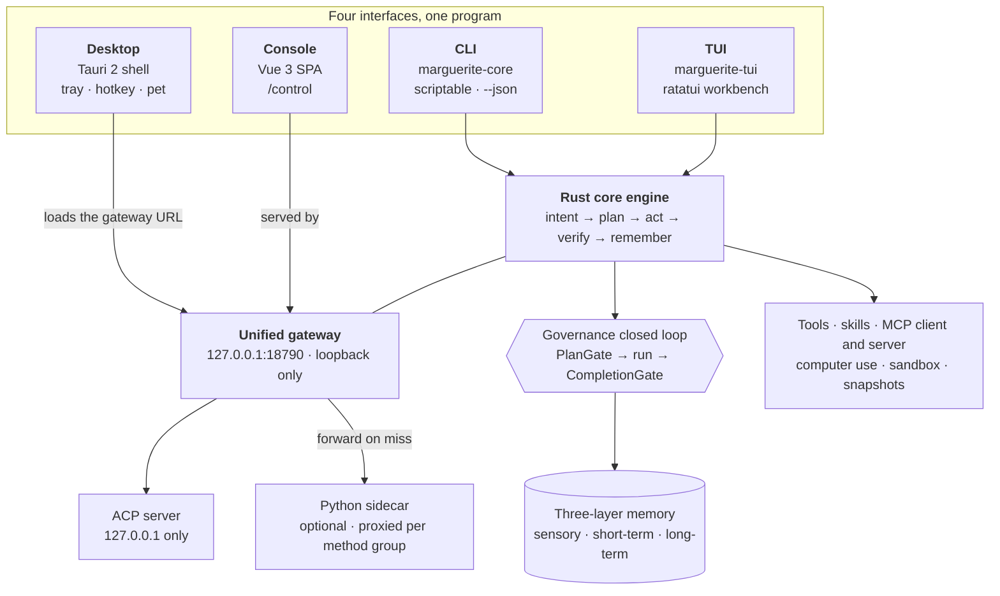

<div align="center">

# Marguerite

**One Rust engine. Four front ends. Your machine.**

A terminal-first, local-first agent workbench — CLI, TUI, Tauri desktop and a
loopback web console all driving the same engine, the same sessions and the same
memory. No account, no cloud relay, no telemetry.

[](https://github.com/KLJyouth1/Marguerite/actions/workflows/ci.yml)
[](LICENSE)
[](rust-toolchain.toml)
[](webui/.node-version)
[](#-quality-gates)
[](#-security-model)
[](#-recursive-self-improvement)

[Docs](docs/README.md) · [Architecture](docs/architecture.md) · [CLI reference](docs/cli-reference.md) · [Contributing](CONTRIBUTING.md)

<p align="center">
  <b>English</b> · <a href="README.zh-Hans.md">中文</a>
</p>

</div>

---

**Contents** · [A look at it](#a-look-at-it) · [Why this exists](#why-this-exists) ·
[How this got built](#-how-this-got-built) ·
[How it fits together](#-how-it-fits-together) ·
[Recursive self-improvement](#-recursive-self-improvement) · [Quickstart](#-quickstart) ·
[What's actually in here](#-whats-actually-in-here) ·
[Security model](#-security-model) · [Quality gates](#-quality-gates) ·
[Layout](#-layout) · [Status](#-status) · [Related repositories](#-related-repositories) ·
[Contributing](#-contributing)

## A look at it

<p align="center">
  
  <br>
  <em>The terminal workbench, which is the primary interface: activity rail, workspace tree,
  <code>Chat</code> / <code>Code</code> / <code>Terminal</code> tabs, and the live
  agent · model · token strip. This is a real rendered frame, not a mock-up.</em>
</p>

<p align="center">
  
  <br>
  <em>The console on first launch. No bundled demo sessions, no seeded activity — the
  empty state is the real one.</em>
</p>

<p align="center">
  
  <br>
  <em>Ask for something and the engine answers with its <strong>plan</strong>, not just prose:
  the orchestration shape it chose, why it chose it, and the step list — then it runs.</em>
</p>

> The screenshots above are generated, not hand-taken. The **TUI** one comes from
> `cargo run -p marguerite-core --example tui_frame`, which renders a real frame through
> ratatui's `TestBackend` — no pty, no terminal, no interactive session — and
> `scripts/demo/render_tui.py` turns that ANSI stream into a PNG. The **console** ones come
> from `python scripts/demo/capture_console.py`. A local mock model
> (`scripts/demo/mock_llm.py`) drives them, so regenerating them needs no API key.
> They are captured with the console in **Chinese** because the plan steps and the
> `计划：…` heading are produced by the Rust engine and are not localized yet; wrapping
> English chrome around Chinese plan content read as half-translated. Pass
> `--locale en` (optionally with `--suffix`) to capture either direction.

## Why this exists

Most agent tooling makes you choose: a CLI that can't show you anything, or a GUI
that owns your data. Marguerite refuses the trade. A single Rust core exposes four
interfaces, and **all four are the same program** — same planner, same tools, same
session store, same local memory.

| | Interface | What it's for |
|---|---|---|
| ⌨️ | **CLI** (`marguerite-core`) | Scriptable single-shot and pipe modes, 20 subcommands, `--json` contracts |
| 🖥️ | **TUI** (`marguerite-tui`) | Full-screen ratatui workbench for long sessions |
| 🪟 | **Desktop** (`marguerite-gui`) | Tauri 2 shell with tray, global hotkey and a floating desktop pet |
| 🌐 | **Web console** | Vue 3 SPA served by the gateway on `127.0.0.1:18790` |

Three design rules fall out of that, and they are enforced in code, not just in prose:

1. **Loopback only.** The gateway and the ACP server bind `127.0.0.1` and nothing else.
   There is no code path that listens on `0.0.0.0`. See [Security model](#-security-model).
2. **Offline is a first-class path.** With no model key configured you still get a real
   answer: the local rule-based orchestrator reports the plan it derived and exits `0`.
   It never fabricates a model completion. See [Quickstart](#-quickstart).
3. **Governance is a closed loop.** `PlanGate` checks the constitution *before*
   execution; `CompletionGate` verifies claimed artifacts actually landed on disk
   *after*. A run that claims a file it never wrote fails its own completion check.

## 🕰️ How this got built

> This section is not a pitch; it is a ledger. The full version — with the late-night
> illustration and the commit-hour chart — is on the
> [website](https://kljyouth1.github.io/Marguerite/#story).

Three years, one person, from "writing code" to "building a workbench I want to open
every day".

| Year | That chapter |
|---|---|
| **2023 · Working solo** | Client work, project lead, teaching. Tools changed every few months; the conclusion did not: every assistant only knows the window you have open. Switch away and it forgets, close it and it scatters, change machines and you start from zero. |
| **2024 · Trying all of it** | Chat models at home and abroad, IDEs, agent workbenches, editor plugins — wire one in, take it apart, move to the next. I also configured LoRA runs myself and wrote a set of skills and agents for each assistant; all of it ended up scattered across folders. The archive still holds what I dismantled: `archived-claude-code-source`, `archived-LLaMA-Factory`, `archived-hermes-telegram`, `agentpot`, `gui-agent`. None of them kept *my process*. |
| **2025 · Writing the core** | First agent loop, first tool protocol, first MCP subprocess. The goal moved from "it works" to "it can be re-checked": every step leaves a receipt, every conclusion can be re-run, and it still starts offline. |
| **2026 · Closing the loop, no cut-down build** | In 32 days it went from 0.2.7 to 0.2.17, packing a 204.9 MB offline WebView2, a 209.6 MB bundled Python 3.12 and all-green gates into one installer. Some call that over-engineering; the answer is one line: I use this machine every day too. |

**Three numbers, three different kinds of claim:**

| Number | What it is |
|---|---|
| ≈ **$30,000** | Paid directly to model and API bills over three years (author's account) |
| ≈ **40 billion tokens** | Back-computed at a blended $0.75 per million; the real range is 300–600 billion — an estimate, not an invoice |
| ≈ **9,700 hours** | 3 years × 340 days × 9.5 hours a day (an estimate) |

**The hours leave a trace.** Across the 54 commits up to `0.2.17`, 21:00–23:00 are the
busiest hours (8 each), with 3 commits at midnight and 1 at 02:00. The schedule used to
run 08:00 to 03:30; after a few hospital visits it became 05:00 to 23:30 — not discipline,
the body filing an objection. Meals out and trips away still meant a remote desktop open
in the bag.

**Fourteen model providers have actually been wired into this workbench**
(see `core/src`): DeepSeek · Ollama · OpenAI · Anthropic · Gemini · Qwen · Kimi ·
Doubao · Hunyuan · Zhipu GLM · Moonshot · Mistral · SiliconFlow · OpenRouter. No ad slots,
nobody excluded.

> I don't ship a cut-down build, because I am the person who opens it every day.

*Provenance: line counts, file counts, skill counts, tool modules and commit hours are
measured from this repository (2026-10-28); three years, $30,000, hospital visits and the
schedule are the author's account; the token figure is an estimate derived from a blended
price. This section does not claim anything that did not happen.*

## 🏗️ How it fits together

One engine in the middle; four faces around it; nothing leaves the machine unless you
point a model endpoint at one.



> [!NOTE]
> `workbench/` is deliberately **not** in that diagram. It is a separate sub-project with
> its own Python backend, its own React SPA and its own version line; it bridges the core
> store the same way the sidecar does, and the Rust binaries do not import it.

## 🧬 Recursive self-improvement

Most agent tooling stops at *it ran*. Marguerite asks the next question:
**did this run make the next one easier?** A loop repeats; a flywheel compounds.
The harness is built around that distinction.

The parts already ship. `harness/meta.rs` runs *monitor → diagnose → plan →
sandbox-evaluate → version-close*; `evolve.rs` keeps round history with rollback;
`eval.rs` scores runs; `ledger.rs` replays deterministically. What is being added
now is **reach** — which objects may be improved — and **gates** — which
improvements are allowed to survive.

| Layer | Responsibility | Lives in |
|---|---|---|
| **L1** inner loop | observe → decide → act → observe; every step emits *completion evidence*, not just "done" | `agent/stream_loop.rs` |
| **L2** shared stack | tool / skill / hand-off / verification — four layers reused across tasks, so one fix benefits many | `tools/`, `agent/` |
| **L3** outer loop | diagnose → targeted data → candidate → sandbox replay → adopt or roll back | `harness/evolve.rs` |
| **L4** gates | selection (gain) · regression (per-task loss cap) · cost (token + latency) | `harness/meta.rs` |
| **L5** meta | the gates themselves, the data policy and the eval set become change targets | `harness/meta.rs` |

**Ten objects, one loop.** Improvement is not limited to the system prompt:

> main agent · sub-agent · sub-sub-agent · expert (48 roles) · team (9) ·
> swarm · memory · experience · knowledge base · skills and tools

**Three boundaries, enforced by types rather than by prose:**

| Boundary | How it is held |
|---|---|
| Core source is **not** a change target | `ChangeTarget` has no such variant; a guard test asserts its absence |
| **Nothing auto-ships** | `MetaPolicy::auto_apply` defaults to `false`; proposals queue for human approval before staged rollout |
| **Cost is a gate** | token and latency growth are measured against baseline — "better and twice as expensive" is rejected |

**Why a regression gate, and not just a score.** From the published record: total
success climbed from 7 of 50 to 11 of 50 while one task quietly lost two previously-passing
states. The aggregate read as progress. It was rejected. *A number that rises while
a capability falls is not improvement* — so a candidate must clear a per-task loss
cap and a protected-task list before its total is even looked at.

**Telling recursive from merely iterative.** Each round reports `delta` (speed),
`delta_of_delta` (acceleration) and `reuse_rate` — the share of last round's
distilled knowledge that this round actually called. If nothing from last round was
reused, the system is relearning, not compounding.

<sub>L1–L4 exist today. Extending reach past the current six change targets, and adding
the regression gate and the acceleration report, is the active work — see
[docs/prd/2026-10-26-rsi-roadmap.md](docs/prd/2026-10-26-rsi-roadmap.md).</sub>

## 🚀 Quickstart

### Prerequisites

| Tool | Minimum | Notes |
|---|---|---|
| Rust | **1.95.0** | Pinned in [`rust-toolchain.toml`](rust-toolchain.toml). `yrs` 0.27 needs `if-let-guard` (RFC 2294), so an older stable will not compile. |
| Node.js | **22.12.0** | Only needed for the web console and the desktop bundle. Pinned in [`webui/.node-version`](webui/.node-version); `webui/package.json` declares `engines.node >= 22.12.0` (Vite 8 / Vitest 4 — Node 20 is **not** enough). |

On Debian/Ubuntu, install the pinned Node major with NodeSource:

```bash
curl -fsSL https://deb.nodesource.com/setup_22.x | sudo -E bash -
sudo apt-get install -y nodejs
```

Tauri 2's Linux build additionally needs the WebKitGTK development packages; see the
`Install Tauri 2 Linux system dependencies` step in [`.github/workflows/ci.yml`](.github/workflows/ci.yml)
for the exact list.

### Try it with no API key (about 60 seconds)

```bash
git clone https://github.com/KLJyouth1/Marguerite.git
cd Marguerite

# Fast path: just the CLI. Compiles in a minute or two.
cargo build -p marguerite-core --bin marguerite-core

# Ask something. With no key configured this returns a real offline plan, exit code 0.
./target/debug/marguerite-core -p "organise this directory by file type"
```

You will get a truthful report of what the engine decided — strategy, intent,
complexity, subtask count — plus the exact command to configure a model. No key,
no network, no fabricated output.

### Now the full stack

> ⚠️ **`cargo build --workspace` requires the web console to be built first.**
> `gui/src-tauri` declares `webui/dist` as a bundled Tauri resource, and Tauri 2
> aborts its build script when a declared resource path is missing. A fresh clone
> has no `webui/dist` (it is generated), so build it before the workspace:
>
> ```bash
> cd webui && npm ci && npm run build && cd ..
> cargo build --workspace
> ```

Then bring up the gateway and open the console:

```bash
./target/debug/marguerite-core gateway      # binds 127.0.0.1:18790
# open http://127.0.0.1:18790/control/
```

Sanity-check the install at any point:

```bash
./target/debug/marguerite-core doctor       # 10-point environment self-check
./target/debug/marguerite-core --help       # all 20 subcommands
```

### Connect a model

A key is **not** required to explore, but it is required for real completions.
Keys are read from the process environment or a `.env` file, and are **never**
written into `config.yaml`:

```bash
export MARGUERITE_API_KEY=sk-...
./target/debug/marguerite-core -p "explain src/main.rs" -f src/main.rs

# or persist it to ~/.marguerite/.env
./target/debug/marguerite-core model add --id my-model --base-url https://api.deepseek.com/v1
```

Any OpenAI-compatible endpoint works (`MARGUERITE_BASE_URL`), including a local
llama.cpp or Ollama server.

## 🧭 What's actually in here

Marguerite does not claim a feature it cannot run. `capabilities` is a self-audit
that reports each capability as fully implemented, partial, or narrative-only:

```bash
./target/debug/marguerite-core capabilities
# 97 total | 96 implemented (85 real + 11 partial) | 1 narrative-only
```

The parts worth your attention:

- **Orchestration that picks its own shape.** Solo / MAX / team / cluster / swarm DAG —
  chosen by a rule engine from the task itself, not by a menu.
- **A mode system that is a trust dial.** `plan` / `agent` / `ensemble` / `bloom` /
  `omni` map onto how much autonomy the agent gets, with anchoring stages that
  **only ever add** tools mid-session, never retract them.
- **Three-layer memory, on disk.** Sensory → short-term → long-term, with local
  embeddings by default and an optional real-model backend behind a feature flag.
- **Skills and plugins, JIT.** YAML skills triggered by intent; manifests bridge
  external harnesses into the same plugin registry the built-ins use.
- **Snapshot and rollback.** Every session gets tar+sha256 snapshots, so an agent
  edit is reversible.
- **MCP on both sides.** Marguerite is an MCP client *and* an MCP server.
- **Computer use.** Screenshot perception, keyboard/mouse control and a vision
  grounding loop.

### CLI surface

```text
doctor  model  mcp  skills  session  exec  deploy  serve  sandbox  subagent
team    browser  chat  gateway  goal  capabilities  cache  dispatch  games
export-diagnostics
```

Every command honours the same output contract: structured errors on stderr with
meaningful exit codes, `--json` for machine consumption, `NO_COLOR` respected, and
ASCII `[OK]`/`[FAIL]` markers instead of emoji.

## 🔒 Security model

This is the part most agent projects get wrong, so it is stated plainly:

- **The gateway and ACP server bind loopback only.** Not "by default" — there is no
  configuration that makes them public.
- **Four guardrail layers** sit between the model and your filesystem, including a
  `PlanGate` constitution check and a `CompletionGate` that verifies self-reported
  artifacts against the disk.
- **Secrets never touch `config.yaml`.** Model keys come from the environment or
  `.env`; the repo ships a `.gitignore` that excludes them.
- **SSRF guard and sandbox profiles.** Egress is filtered, and the Linux sandbox
  uses Landlock where available. On platforms without an OS sandbox, the engine
  degrades to read-only rather than pretending it is contained — `doctor` tells you
  which mode you are in.
- **No telemetry.** There is no analytics endpoint in the codebase.

Found a vulnerability? See [SECURITY.md](SECURITY.md) — please report privately.

## ✅ Quality gates

This repository's rule is blunt: **no completion claim without fresh verification
evidence.** The gate is a script, not a vibe.

```bash
bash scripts/verify.sh --all          # core + webui + gui + pyengine + workspace build + clippy
bash scripts/verify.sh --clean --all  # same, after clearing incremental caches
bash scripts/verify.sh --fast         # pre-commit: tests + clippy + typecheck
bash scripts/verify.sh --pyengine     # Python sidecar only (tests/unit + tests/test_gateway + the contract family, no network, no LLM)
bash scripts/verify.sh --workbench    # workbench sub-project only (71 offline tests + version sync)
bash scripts/verify.sh --release      # adds the Tauri release bundle
```

Current baseline — the full gate dispatches 26 checks, and the last complete run that
recorded **26/26** was on 2026-10-31; every number in the table below comes from that run. Every layer
below runs in CI (`.github/workflows/ci.yml`) except the web e2e layer, which is
**local-gate-only for now**: CI would need a Playwright browser cache and a
Rust-built gateway in the same job (tracked as follow-up, not silently claimed).

| Gate | Result |
|---|---|
| `cargo test -p marguerite-core --lib` | 4533 passed / 0 failed / 25 ignored |
| core integration tests (`core/tests/{e2e,plugin_manifest_gate,plugin_patch_gate,tui_model_panel}`) | offline and deterministic; `third_party_integration` is `[SKIP]` when `third_party/` is absent (a skip is never counted as a pass) |
| `webui` unit tests (Vitest) | 5085 passed / 0 failed (516 files) |
| `pyengine` unit tests (pytest, `tests/unit`) | 823 passed / 0 failed / 7 skipped |
| `pyengine` gateway contracts (pytest, `tests/test_gateway`) | 2956 passed / 0 failed / 11 skipped |
| `pyengine` contract family (pytest, `tests/test_{ci,migrations,sandbox,onboarding,tools,recovery}`) | 4387 passed / 0 failed / 390 skipped |
| `cargo clippy --workspace --all-targets -- -D warnings` | zero warnings |
| `npm run check:architecture` | 13 architecture guards green |
| `scripts/check-doc-cli-drift.py` | every documented CLI token resolves to real code |
| `scripts/check-version-sync.py` | core / tui / gui / webui versions pinned to `core/Cargo.toml`, incl. both npm lockfile self-entries |
| `npm ci --dry-run` | console lockfile is self-consistent with `package.json` (the check `npm audit` cannot see) |
| `npm audit --audit-level=moderate` | console dependency tree free of moderate+ advisories |
| i18n | 6 locales at full parity (6297 keys each), plus a source-vs-dictionary check so a key no locale defines cannot ship |
| `scripts/check-secrets.py` | no real-looking API key in any file that would ship — a fixture must label itself (`sk-fake-…`) or it fails |
| `scripts/check-doc-links.py` | every relative link in this project's own docs resolves (vendored skill packs are out of scope) |
| `scripts/check-readme-claims.py` | the English and Chinese READMEs agree on every hard fact, and the gate total they print is the number of checks `verify.sh --all` actually dispatches |
| `scripts/check-batch-parse.py` | every tracked `.cmd`/`.bat` is dry-run through `cmd.exe` with its commands neutered to `echo`; a UTF-8-without-BOM Chinese script gets its lines split mid-character into phantom commands (measured: 71 stderr lines from `package_full.cmd`), so the packaging scripts ship as GBK + CRLF and this proves the parser agrees |
| `scripts/check-website-claims.py` | the landing page's 23 printed numbers (code lines, architecture guards, RPC declarations, CLI routes, test baselines, BPM) are re-measured from the shipping file set, every path it cites exists, and it links no source repository — runs in CI, not in `verify.sh`, so the gate total above stays the dispatched count |
| `workbench` backend tests (pytest) | 71 offline tests — this sub-project ships, so it is gated like the rest |
| `workbench` version sync | its own `VERSION` line matches the backend and frontend declarations |
| web e2e (Playwright) | an isolated gateway (temp HOME + `MARGUERITE_CONFIG_DIR`, dedicated port) runs the deterministic spec subset; its pass count is a ratchet that may only rise, and the not-yet-deterministic specs are listed as a backlog instead of being called green |

The Python sidecar is gated at **three layers**: `tests/unit` deselects the markers that
reach the real world (network, model APIs, Playwright, a real terminal),
`tests/test_gateway` — the gateway's own contract suite, which carries no such markers —
runs in full, and the **contract family** (`tests/test_ci`, `test_migrations`,
`test_sandbox`, `test_onboarding`, `test_tools`, `test_recovery`) runs as a third layer.
If `python` or `pytest` is missing the gate reports **`[SKIP]` and counts
it as *not verified*** — a skip is never silently promoted to a pass, which is also why
every layer prints its skips together with their reasons. The gateway layer's 11
skips are 10 POSIX-only filesystem cases (they do run on Linux CI) plus the one named
upstream-document skip; the contract family's 390 are the same kind of POSIX-only case
plus the named upstream-scaffolding skips inherited with `pyengine/`.

The contract family was added because it had **never been run by any gate**: measured
before the round, those six directories held 30 failures nobody could see
(`test_sandbox` 11, `test_recovery` 14, `test_onboarding` 3, `test_tools` 2), including
two real Windows-only product defects — `os.fchmod` exists on Windows from CPython 3.13
on, so the recovery transactions' capability probe turned owner-only hardening into a
hard failure, and a symlink loop in the workspace raised a raw `OSError` instead of
falling back to the home directory. 25 of the 30 were fixed; the other 5 assert
POSIX path semantics or upstream tooling that was never migrated, and are skipped
with a named reason instead of being called green.

All three layers run as a **CI job of its own**. It was not one until recently: every other
ci.yml job is Rust or Node, so a green badge said nothing about the `pyengine/` tree
even though this README advertised the gate. The job runs this same gate layer rather
than a copy of the pytest invocation, so the marker list has exactly one definition,
and it asserts up front that `pytest` imports — precisely because the gate treats a
missing prerequisite as `[SKIP]` and still exits `0`.

Run it yourself — the numbers above are only meaningful if you can reproduce them:

```bash
unset NO_COLOR && bash scripts/verify.sh --clean --all
```

On a fresh clone that command also proves the onboarding path: `webui/dist` is a
git-ignored build product that `gui/src-tauri` declares as a Tauri resource, so the
gate builds the console itself before touching the workspace. You should never have
to discover that ordering by reading a stack trace.

`verify.sh` also refuses to be fooled by caches: `--clean` exists specifically so a
stale incremental build cannot be mistaken for a passing one.

## 📁 Layout

```text
core/        Rust engine + CLI binary + ACP shell      (~265k lines)
tui/         ratatui full-screen workbench
gui/         Tauri 2 desktop shell (Rust in src-tauri/)
webui/       Vue 3 + Pinia console, served by the gateway
pyengine/    Python sidecar (optional), reached through the gateway
workbench/   Separate sub-project: file-intelligence + LLM-lab backend (FastAPI :8011) and its React SPA
skills/      YAML skills, triggered just-in-time by intent
docs/        Architecture, CLI reference, MCP, development guide
scripts/     verify.sh and the packaging pipeline
```

## 🗺️ Status

Marguerite is **pre-1.0 and moving fast**. Honest notes:

- Version numbers across the four front ends are now pinned to `core/Cargo.toml`
  and enforced by `scripts/check-version-sync.py` in CI. The engine version is
  authoritative (`marguerite-core --version`; currently `0.2.19`).
- The desktop app expects the web console bundle next to it. Run it from a packaged
  installer or from the repository — a bare copied `.exe` cannot serve a console it
  does not have. Since this round it no longer fails silently in that case: the
  gateway answers `/control/` with `503` plus a self-contained diagnostic page
  listing every path it probed, and the window renders that page.
- Distribution packages are **not** published yet; build from source as above. The
  release workflow exists and is wired to `v*` tags, but no tag has been pushed.
- `workbench/` is a **separate sub-project**, not a fifth front end of the Rust engine:
  its own Python backend (`engine` · `api` · `cli` · `llmlab` · `ttc` · `agentloop`),
  its own React SPA served by FastAPI on `:8011`, its own packaging pipeline, and
  **its own version line** (`workbench/VERSION`, currently `1.1.0` — independent of the
  engine's `0.2.19`). It bridges the core store through `core_bridge`, in the same spirit
  as `pyengine/`; the Rust binaries do not import it. Its 71 offline tests and its
  version gate had never been run by any gate until this round, even though the
  sub-project ships — `verify.sh --workbench` now covers both.
- `gui/src` — the React front end that CI built but the product UI never showed — **has
  been removed**. The Tauri window loads the gateway URL (`http://127.0.0.1:18790/control/`),
  which serves the Vue console, so `gui/` is now a **pure shell** and `webui/` is the single
  front end. The archived tree is kept at `docs/legacy/gui-react-2026-10-21/`; three guards
  (`check_gui_shell_config.py`, the tail of `check-tokens-sync.mjs`, and
  `verify:no-frontend`) fail if it reappears.
- The README ships in English and Simplified Chinese only, while the app UI is
  localized into six locales (en, zh-Hans, ja, fr, de, es). The locale-parity guard
  treats the missing README translations as a reported gap, not a build failure.
- The **console is localized; the engine's generated content is not**. `decompose()` in
  the Rust core emits Chinese plan steps and a `计划：…` heading, so any non-Chinese UI
  renders localized chrome around Chinese plan content — which is why the screenshots
  above use the Chinese console. Related and fixed this round: an absent plan title used
  to fall back to a hardcoded `未命名计划`, leaking Chinese even into the English UI. It is
  now derived from the prompt (first 40 characters) — the same rule `plans.analyze` already
  used for its preview, so preview and persisted revisions finally agree.
- The creation intent recognises **natural English phrasing only partially**. `Build me a
  polished first-person shooter game` used to score zero on every rule and land in
  `Unknown`; it now resolves to `Build`, but at confidence **0.27** — still below the 0.6
  threshold, so it asks the LLM to disambiguate. The Chinese equivalent reaches **0.645**
  with no LLM round-trip. Scoring is `hits / keyword-count`, so widening the keyword list
  is not the fix: 12 → 14 keywords dilutes the Chinese path to 0.591 and breaks its
  regression test. Closing the gap needs a scoring change, not more synonyms.
- The console used to probe three REST endpoints the gateway did not implement —
  `GET /api/approvals`, `GET /api/system/update`, `POST /api/elevated-mode` — and each
  returned the catch-all **501**. As of R61 the gateway serves them: `/api/approvals*` is a
  native Rust route, and everything else under `/api/*` is **proxied to the Python sidecar
  when it is online** (offline it still returns 501, and the UI degrades gracefully).
- The Python sidecar's test suite was, until recently, **not run by any gate at all**
  and could not even be collected: a missing `pythonpath` entry meant a bare `pytest`
  resolved `1553 tests / 1146 errors`, which reads like mass breakage but was one config
  line. A bare `pytest` now collects **`20668 tests / 0 errors`**, and the gate runs
  `tests/unit` (823 passing), `tests/test_gateway` (2956 passing) and the contract family
  as a third layer. Collection being
  clean is not the same as the suite being green, and the difference is now enumerated
  rather than assumed:
  `pyengine/tests/conftest.py` refuses to collect **45 modules** and names the reason for
  each in the terminal summary. Forty-one are **missing prerequisites** — developer/release
  tooling never migrated into this tree (`pyengine/scripts/*`, `pyengine/.github/scripts/*`)
  or living in the optional dev-dependency group (`syrupy`, `laboratory`, `mypy`). Those are
  self-healing: restore the prerequisite and the module is collected again, no conftest edit.
  The other four are **inherited upstream contracts** — they assert a *different*
  repository's CI (its `.github/workflows/*.yml`, its `.github/scripts/*`, its
  `scripts/classify-ci-changes.sh`, its `opensquilla-webui/` console directory). Those will
  **not** self-heal and are labelled as such. Measured effect on `tests/test_ci`:
  **94 failed / 41 passed → 0 failed / 35 passed**.
  Everything outside those three layers is still executed by no gate, and a full-tree run
  does not complete here: it burned 22 minutes of wall clock at **8% CPU** — blocked on
  external I/O rather than computing, which is precisely why the gate confines itself to
  the layers it can actually finish. `tests/test_gateway` was one of those unrun
  directories — 2901 passing tests and **29 failures nobody saw**, because the gate ran
  `tests/unit` and CI only added a *collection* check. All 29 were pre-existing drift, not
  product breakage: 13 static-source contracts read an upstream console directory
  (`opensquilla-webui/`) that was never migrated — this repo's console is `webui/` — so
  they now resolve it through one helper module; 14 auto-summarize fixtures used a budget
  below the post-compaction estimate floor, which only held on a machine with `tiktoken`
  installed (it is an *optional* extra, and the fallback estimator is ~2x more
  conservative); one asserted `importlib.metadata` against a package this repo never
  installs; and one asserted a section of an upstream troubleshooting guide that was never
  migrated (now an explicit, named skip).
  A further 395 bare `path.read_text()` calls across 81 test files remain locale-fragile —
  see AGENTS.md §2.
- **`pyengine/` cannot be installed or built from this repository.** Its build backend fails
  closed by design: `hatch_build.py` demands a *verified* WebUI artifact at
  `src/opensquilla/gateway/static/dist` (absent here) and inspects an `opensquilla-webui/`
  directory that was never migrated — this repo's console is `webui/`. So
  `pip install -e pyengine` fails, and the CI job installs the declared dependency sets from
  `pyproject.toml` rather than building the package. The suite does not need it installed at
  all: `pythonpath = ["src"]` is sufficient, which is why all gated tests pass on a
  machine where `pip show opensquilla` prints nothing.
- Two long-standing product defects were fixed and pinned by tests this round.
  The intent classifier had **no build/create intent at all**, so
  "帮我做一个完善的 FPS 第一人称射击游戏" scored zero on all seven rules and was
  reported as `Unknown`; there is now a first-class `Build` intent (`编码`), and the
  game request resolves to `Build` with confidence 0.65 and no forced LLM
  disambiguation. Separately, the sidebar's primary rail was being crushed to
  **14px** by flex shrinking — its rows kept their layout boxes but their text was
  clipped away, leaving an unlabelled bar and three unreachable destinations —
  while the Settings footer sat at y=1062 in a 900px column and could not be
  clicked at all. Root cause and the three-part fix are in [AGENTS.md](AGENTS.md) §4.
- Internal working notes are quarantined under `docs/internal/` (phase progress logs,
  the L3 sandbox security audit, the local-model workbench design) alongside
  `docs/planning/`, `docs/reports/`, `docs/research/` and `docs/archive/`. None of it is
  part of the user-facing contract; where it disagrees with the code, the code wins.
  The repository root holds only entry points, build manifests and build scripts.

## 📦 Related repositories

This is the **source** repository. Two sibling repositories carry the binaries and the model:

| Repository | What is in it |
|---|---|
| **[Marguerite](https://github.com/KLJyouth1/Marguerite)** — this repo | Rust engine, TUI, Tauri desktop app, loopback web console, Python sidecar |
| **[Marguerite-Releases](https://github.com/KLJyouth1/Marguerite-Releases)** | Installers: `.msi` (WiX) and `-setup.exe` (NSIS), each release with `SHA256SUMS.txt` |
| **[KLJyouth-office-Modle](https://github.com/KLJyouth1/KLJyouth-office-Modle)** | The companion local decision model (Qwen2.5-1.5B + 4-bit QLoRA, ~4.4M trainable params): tool-domain/tool selection, accept-reject scoring, abstain. fp16 GGUF / safetensors / q4_K_M, with SHA256SUMS. |

Just want to **run** Marguerite? Download an installer from
[Marguerite-Releases](https://github.com/KLJyouth1/Marguerite-Releases/releases/latest).
Build from source only if you intend to change the engine or the UI.

## 🤝 Contributing

Contributions are welcome. Start with [CONTRIBUTING.md](CONTRIBUTING.md); the short
version is that a change is done when `bash scripts/verify.sh --all` is green and no
test baseline regressed. [AGENTS.md](AGENTS.md) documents the architectural
invariants that reviews check against, and is the fastest way to understand why the
code is shaped the way it is.

## 📄 License

MIT — see [LICENSE](LICENSE).
