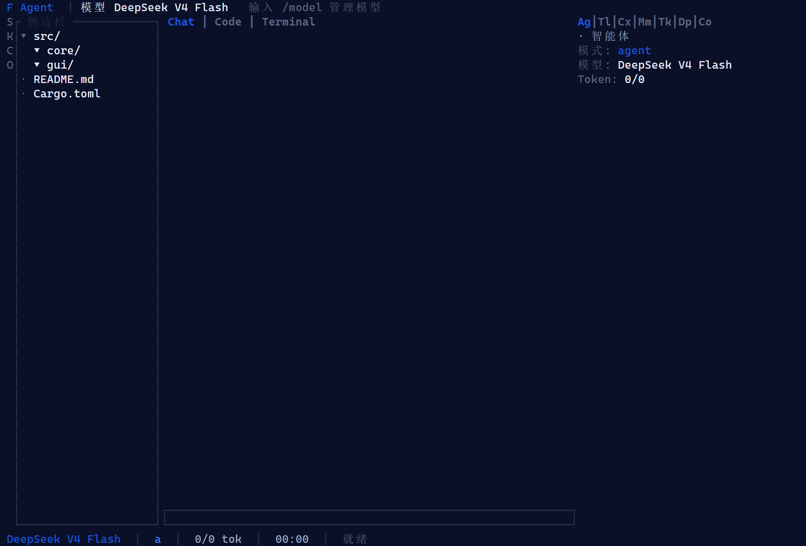
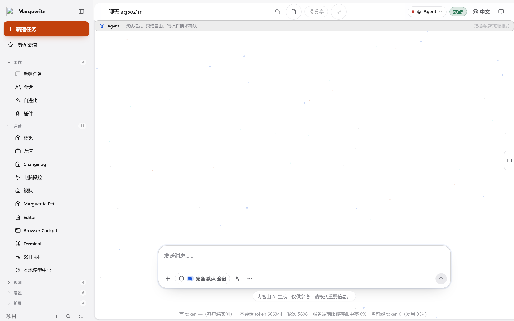
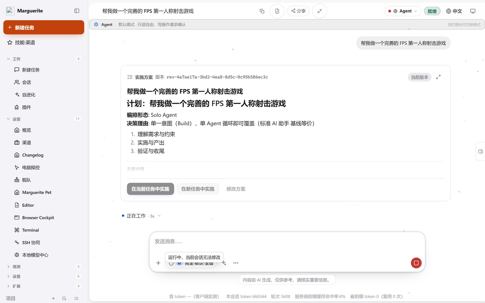
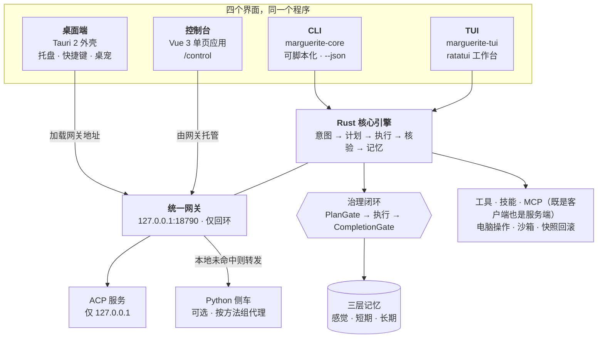

<div align="center">

# Marguerite

**一个 Rust 引擎，四个前端，全在你自己的机器上。**

终端优先、本地优先的智能体工作台 —— CLI、TUI、Tauri 桌面端与回环 Web 控制台
共用同一个引擎、同一份会话、同一套记忆。无需账号，不经云端中转，不带遥测。

[](https://github.com/KLJyouth1/Marguerite/actions/workflows/ci.yml)
[](LICENSE)
[](rust-toolchain.toml)
[](webui/.node-version)
[](#-质量门禁)
[](#-安全模型)
[](#-递归自我改进)

[文档索引](docs/README.md) · [架构](docs/architecture.md) · [CLI 手册](docs/cli-reference.md) · [贡献指南](CONTRIBUTING.md)

<p align="center">
  <a href="README.md">English</a> · <b>中文</b>
</p>

</div>

---

**目录** · [长什么样](#长什么样) · [为什么做这件事](#为什么做这件事) ·
[开发史](#-一个人的工作台开发史) · [各部分如何咬合](#-各部分如何咬合) · [递归自我改进](#-递归自我改进) ·
[快速开始](#-快速开始) · [里面到底有什么](#-里面到底有什么) ·
[安全模型](#-安全模型) · [质量门禁](#-质量门禁) · [目录结构](#-目录结构) ·
[当前状态](#-当前状态) · [相关仓库](#-相关仓库) · [参与贡献](#-参与贡献)

## 长什么样

<p align="center">
  
  <br>
  <em>终端工作台（产品的主界面）：左侧活动栏、工作区文件树、<code>Chat</code> / <code>Code</code> /
  <code>Terminal</code> 三个标签页，右侧是实时的 智能体 · 模型 · Token 状态条。
  <strong>这是真实渲染的一帧，不是示意图。</strong></em>
</p>

<p align="center">
  
  <br>
  <em>控制台的首次启动画面。没有内置演示会话、没有预置活动记录 —— 空态就是真实的空态。</em>
</p>

<p align="center">
  
  <br>
  <em>提出需求后，引擎先给出<strong>计划</strong>而不是一段空话：它选定的编排形态、选择理由、
  以及步骤清单 —— 然后才开始执行。</em>
</p>

> 上面的截图是**脚本生成**的，不是手工截的。**TUI** 那张来自
> `cargo run -p marguerite-core --example tui_frame`：它用 ratatui 的 `TestBackend`
> 渲染**真实的一帧**（不需要 pty、不需要真终端、不需要交互会话），再由
> `scripts/demo/render_tui.py` 把 ANSI 流转成 PNG。**控制台**那两张来自
> `python scripts/demo/capture_console.py`，由本地 mock 模型
> （`scripts/demo/mock_llm.py`）驱动，所以重新生成不需要任何 API Key。
> 控制台刻意截的是**中文界面**：计划步骤与 `计划：…` 标题由 Rust 引擎生成，目前尚未本地化，
> 给中文内容套一层英文外壳会显得只翻译了一半。加 `--locale en`（可配 `--suffix`）即可出另一个方向。

## 为什么做这件事

多数智能体工具逼你二选一：能干活但看不见过程的 CLI，或者吃掉你数据的 GUI。
Marguerite 拒绝这个取舍 —— 一个 Rust 内核暴露四个界面，而这**四个界面是同一个程序**：
同一套规划器、同一批工具、同一个会话存储、同一份本地记忆。

| | 界面 | 用途 |
|---|---|---|
| ⌨️ | **CLI**（`marguerite-core`） | 可脚本化的单发与管道模式、20 个子命令、`--json` 契约 |
| 🖥️ | **TUI**（`marguerite-tui`） | ratatui 全屏工作台，适合长会话 |
| 🪟 | **桌面端**（`marguerite-gui`） | Tauri 2 外壳：托盘、全局快捷键、桌宠悬浮窗 |
| 🌐 | **Web 控制台** | 由网关在 `127.0.0.1:18790` 托管的 Vue 3 单页应用 |

由此推出三条设计铁律，它们是**代码强制**的，不只是文档里的口号：

1. **只监听回环。** 网关与 ACP 服务只绑定 `127.0.0.1`，不存在任何监听 `0.0.0.0`
   的代码路径。详见[安全模型](#-安全模型)。
2. **离线是一等路径。** 没配模型密钥时你依然能拿到真实结果：本地规则编排器会如实
   报告它推导出的计划，并退出 `0`；它**绝不会伪造模型回答**。详见[快速开始](#-快速开始)。
3. **治理是闭环的。** 执行前 `PlanGate` 校验宪法条款，产出后 `CompletionGate`
   核验自称落盘的文件是否真的在磁盘上 —— 声称写了文件却没写，会在自己的完成门禁上失败。

## 🕰️ 一个人的工作台开发史

> 这一节不讲卖点，只讲账。官网完整版（带深夜插画与提交时段图）：
> [故事板块](https://kljyouth1.github.io/Marguerite/#story)。

三年，一个人，从「写代码」到「造一台自己愿意每天打开的工作台」。

| 年份 | 那一章 |
|---|---|
| **2023 · 一个人接活** | 写业务、带项目、上课。工具换了一茬又一茬，结论越来越清楚：每个助手都只懂你正打开的那一个窗口 —— 切走就忘，关掉就散，换台机器就等于从零开始。 |
| **2024 · 把能试的都试了** | 国内外的对话模型、IDE、Agent 工作台、编辑器插件，接进来、拆开看、再换下一个。自己也拉过 LoRA 配置调模型，给每个助手写过一套 skills 与智能体，最后都散在各自的文件夹里。归档里还躺着 `archived-claude-code-source`、`archived-LLaMA-Factory`、`archived-hermes-telegram`、`agentpot`、`gui-agent`。试到最后发现：没有一个能留下「我的过程」。 |
| **2025 · 从零写内核** | 第一版 agent 循环、第一套工具协议、第一个 MCP 子进程。目标从「能用」改成「可复核」：每一步要有回执，每个结论要能复跑，断网也要能开工。 |
| **2026 · 收口，不阉割** | 32 天里从 0.2.7 走到 0.2.17，把 204.9 MB 离线 WebView2、209.6 MB 内置 Python 3.12、全绿门禁一起塞进安装包。有人说这是过度设计；他只回一句：我自己每天也要用这台机器。 |

**三笔账**（三种口径，别混着读）：

| 数字 | 是什么 |
|---|---|
| ≈ **$30,000** | 三年里直接付给模型与 API 的账单（作者自述） |
| ≈ **400 亿 token** | 按混合单价 $0.75 / 百万反推；真实区间 300–600 亿，是估算，不是账单 |
| ≈ **9,700 小时** | 三年 × 每年 340 天 × 每天 9.5 小时（估算） |

**作息是有痕迹的。** 本仓库截至 `0.2.17` 的 54 次提交里，21:00–23:00 最密集（各 8 次），
凌晨 0 点 3 次、2 点 1 次。一度 08:00 干到凌晨 03:30，后来进了几次医院，改成 05:00 起、
23:30 收 —— 不是变自律了，是身体先投了反对票。出门吃饭、在外游玩，包里永远开着一台远程桌面。

**这三年真正接进过这台工作台的 14 个模型入口**（以 `core/src/provider` 为准）：
DeepSeek · Ollama · OpenAI · Anthropic · Gemini · Qwen · Kimi · 豆包 · 混元 · 智谱 GLM ·
Moonshot · Mistral · SiliconFlow · OpenRouter。不是广告位，也没有排除谁。

> 我不做阉割版，因为我自己就是那个每天要打开它的人。

*数据口径：代码行数、文件数、技能数量、工具模块与提交时段来自本仓库实测（2026-10-28）；
三年、3 万美元、就医与作息为作者自述；token 数为按混合单价反推的估算。故事板块不写没发生过的事。*

## 🏗️ 各部分如何咬合

中间只有一个引擎，四周是四张脸；除非你自己把模型端点指向外网，否则什么都不会离开这台机器。



> [!NOTE]
> `workbench/` 是**故意**不画进这张图的。它是独立子项目：自己的 Python 后端、自己的
> React SPA、自己的版本线；它像侧车那样通过 `core_bridge` 桥接核心 store，
> 而 Rust 二进制并不引用它。

## 🧬 递归自我改进

多数智能体工具停在「跑通了」。Marguerite 追问下一句：
**这一轮，有没有让下一轮更容易？** 循环只是重复，飞轮才会复利 —— 整个 harness 围绕这条差别构建。

零件已经在了：`harness/meta.rs` 跑「监控 → 诊断 → 规划 → 沙箱评估 → 版本闭环」，
`evolve.rs` 保存轮次历史并可回滚，`eval.rs` 给每轮打分，`ledger.rs` 做确定性回放。
现在补的是**覆盖面**（哪些对象可以被改进）与**门**（哪些改进允许留下）。

| 层 | 职责 | 位置 |
|---|---|---|
| **L1** 内层循环 | 观察 → 决策 → 执行 → 再观察；每步产出**完成证据**，而不只是「做完了」 | `agent/stream_loop.rs` |
| **L2** 共享执行栈 | 工具 / 技能 / 交接 / 验证 —— 四层跨任务复用，改一处多处受益 | `tools/`、`agent/` |
| **L3** 外层循环 | 诊断 → 定向补经验 → 生成候选 → 沙箱回放 → 采纳或回滚 | `harness/evolve.rs` |
| **L4** 门控 | 选择门（收益）· 回归门（每任务损失上限）· 成本闸（token 与时延） | `harness/meta.rs` |
| **L5** 元改进 | 门控本身、补数据策略、评测集，都成为可改对象 | `harness/meta.rs` |

**十个对象，一个闭环。** 可改进的不只是 system prompt：

> 主智能体 · 子代理 · 子智能体 · 专家（48 角色）· 团队（9 个）·
> 蜂群 · 记忆 · 经验 · 知识库 · 技能与工具

**三条边界，由类型强制，而不是靠文档口号：**

| 边界 | 怎么保证 |
|---|---|
| **不许改核心源码** | `ChangeTarget` 没有这个变体，护栏测试断言其不存在 |
| **绝不自动上线** | `MetaPolicy::auto_apply` 默认 `false`，提案进待审队列，人工批准后才灰度 |
| **成本进闸** | token 与时延相对基线的涨幅会被测量 —— 「变好了但贵一倍」会被拒绝 |

**为什么要回归门，而不只看总分。** 公开记录里有个真实案例：总成功率从 50 项中的 7 项升到 11 项，
但某个任务悄悄丢掉了两个原本能成功的状态。总分看起来是进步，**仍被拒绝**。
*数字上升而能力下降，不是改进* —— 所以候选必须先过「每任务损失上限」与「保护任务清单」，
才轮得到看总分。

**怎么区分「递归」与「只是迭代」。** 每轮报三个数：`delta`（速度）、`delta_of_delta`（加速度）、
`reuse_rate`（上轮沉淀的知识本轮实际被调用的比例）。如果上轮学的东西一次都没用上，
系统只是在重新学，不是复利。

<sub>L1–L4 今天已具备。把可改对象扩到当前六类之外、补上回归门与加速度报告，是正在进行的工作 ——
见 [docs/prd/2026-10-26-rsi-roadmap.md](docs/prd/2026-10-26-rsi-roadmap.md)。</sub>

## 🚀 快速开始

### 环境要求

| 工具 | 最低版本 | 说明 |
|---|---|---|
| Rust | **1.95.0** | 锁定在 [`rust-toolchain.toml`](rust-toolchain.toml)。`yrs` 0.27 需要 `if-let-guard`（RFC 2294），更旧的 stable 编译不过。 |
| Node.js | **22.12.0** | 仅 Web 控制台与桌面打包需要。锁定在 [`webui/.node-version`](webui/.node-version)；`webui/package.json` 声明 `engines.node >= 22.12.0`（Vite 8 / Vitest 4，**Node 20 不够**）。 |

Debian/Ubuntu 上用 NodeSource 安装锁定的 Node 大版本：

```bash
curl -fsSL https://deb.nodesource.com/setup_22.x | sudo -E bash -
sudo apt-get install -y nodejs
```

Tauri 2 在 Linux 上还需 WebKitGTK 开发包，确切清单见
[`.github/workflows/ci.yml`](.github/workflows/ci.yml) 的
`Install Tauri 2 Linux system dependencies` 步骤。

### 不配任何 API Key 先试（约 60 秒）

```bash
git clone https://github.com/KLJyouth1/Marguerite.git
cd Marguerite

# 最快路径：只编 CLI，一两分钟即可
cargo build -p marguerite-core --bin marguerite-core

# 直接提问。未配置密钥时返回真实的离线编排判定，退出码 0
./target/debug/marguerite-core -p "帮我把这个目录按类型整理"
```

你会看到引擎真实推导出的策略、意图、复杂度与子任务数，以及配置模型的确切命令。
没有密钥、没有联网、没有伪造输出。

### 再跑完整技术栈

> ⚠️ **`cargo build --workspace` 需要先构建 Web 控制台。**
> `gui/src-tauri` 把 `webui/dist` 声明为 Tauri 打包资源，而 Tauri 2 在声明的资源路径
> 缺失时会直接中止构建脚本。全新 clone 没有 `webui/dist`（它是生成物），所以要先构建：
>
> ```bash
> cd webui && npm ci && npm run build && cd ..
> cargo build --workspace
> ```

随后拉起网关并打开控制台：

```bash
./target/debug/marguerite-core gateway      # 绑定 127.0.0.1:18790
# 浏览器打开 http://127.0.0.1:18790/control/
```

随时做一次环境自检：

```bash
./target/debug/marguerite-core doctor       # 10 项环境自检
./target/debug/marguerite-core --help       # 全部 20 个子命令
```

### 接入模型

探索阶段**不需要**密钥，但真实补全需要。密钥从进程环境或 `.env` 读取，
**绝不**写进 `config.yaml`：

```bash
export MARGUERITE_API_KEY=sk-...
./target/debug/marguerite-core -p "解释 src/main.rs" -f src/main.rs

# 或者持久化到 ~/.marguerite/.env
./target/debug/marguerite-core model add --id my-model --base-url https://api.deepseek.com/v1
```

任何 OpenAI 兼容端点都能用（`MARGUERITE_BASE_URL`），包括本地 llama.cpp 或 Ollama。

## 🧭 里面到底有什么

Marguerite 不声称自己跑不了的能力。`capabilities` 是一份自审清单，逐项标注
「真货 / 部分实装 / 纯叙事」：

```bash
./target/debug/marguerite-core capabilities
# 全量 88 项 | 已实装 86（真货 80 / 部分 6）| 纯叙事 2
```

值得关注的部分：

- **编排自己决定形态**：Solo / MAX / 团队 / 集群 / swarm DAG，由规则引擎从任务本身推出，
  而不是让你在菜单里选。
- **模式即信任档位**：`plan` / `agent` / `ensemble` / `bloom` / `omni` 对应智能体自主度；
  会话内锚定阶段**只增不减**工具面，绝不中途撤回。
- **三层记忆落盘**：感知 → 短期 → 长期；默认本地嵌入，真实模型后端藏在 feature flag 后。
- **技能与插件 JIT**：YAML 技能按意图触发；清单把外部 harness 桥接进内置技能所用的同一注册表。
- **快照与回滚**：每个会话都有 tar+sha256 快照，智能体的改动可回退。
- **MCP 双向**：Marguerite 既是 MCP 客户端，也是 MCP 服务端。
- **桌面级 computer use**：截图感知 + 键鼠控制 + 视觉闭环定位。

### CLI 面

```text
doctor  model  mcp  skills  session  exec  deploy  serve  sandbox  subagent
team    browser  chat  gateway  goal  capabilities  cache  dispatch  games
export-diagnostics
```

所有命令遵守同一输出契约：结构化错误走 stderr 并带明确退出码、`--json` 供机器消费、
尊重 `NO_COLOR`、用 ASCII `[OK]`/`[FAIL]` 而非 emoji。

## 🔒 安全模型

这是多数智能体项目做错的地方，所以直说：

- **网关与 ACP 只绑回环。** 不是「默认如此」—— 没有任何配置能让它们对外。
- **模型与文件系统之间有四层护栏**，含 `PlanGate` 宪法校验，以及 `CompletionGate`
  把自称的产物与磁盘实际内容对账。
- **密钥不进 `config.yaml`。** 模型密钥来自环境或 `.env`，仓库的 `.gitignore` 已排除它们。
- **SSRF 守卫与沙箱档位。** 出网被过滤；Linux 上可用时走 Landlock。没有 OS 级沙箱的平台
  会**降级为只读**，而不是假装自己被隔离了 —— `doctor` 会告诉你当前处于哪一档。
- **无遥测。** 代码库里没有任何分析上报端点。

发现漏洞请走 [SECURITY.md](SECURITY.md) 的私下上报流程。

## ✅ 质量门禁

本仓库的规矩很硬：**没有新鲜验证证据，不得声称完成。** 门禁是脚本，不是感觉。

```bash
bash scripts/verify.sh --all          # core + webui + gui + pyengine + workspace 构建 + clippy
bash scripts/verify.sh --clean --all  # 同上，但先清增量缓存
bash scripts/verify.sh --fast         # 提交前快闸：测试 + clippy + typecheck
bash scripts/verify.sh --pyengine     # 只跑 Python 侧车（tests/unit + tests/test_gateway + 契约族六个目录，无网络、无 LLM）
bash scripts/verify.sh --workbench    # 只跑 workbench 子项目（71 个离线用例 + 版本一致性）
bash scripts/verify.sh --release      # 追加 Tauri 发布打包
```

当前基线 —— 整道闸门调度 25 项检查，最近一次完整跑到 **25/25 全绿**是 2026-10-28；
下表每一行数字都来自那次运行。其余每一层都在 CI
（[`.github/workflows/ci.yml`](.github/workflows/ci.yml)）里跑，**只有新增的 web e2e
层暂时只在本机闸门里跑**：CI 需要把 Playwright 浏览器缓存与 Rust 构建出的网关放进
同一个 job（列为后续项，不在这里悄悄声称已覆盖）。

| 门禁 | 结果 |
|---|---|
| `cargo test -p marguerite-core --lib` | 4230 passed / 0 failed / 24 ignored |
| core 集成测试（`core/tests/{e2e,plugin_manifest_gate,plugin_patch_gate,tui_model_panel}`） | 离线且确定性；`third_party/` 缺失时 `third_party_integration` 记 `[SKIP]`（跳过永不计入通过） |
| `webui` 单测（Vitest） | 4898 passed / 0 failed（495 个文件） |
| `pyengine` 单测（pytest，`tests/unit`） | 823 passed / 0 failed / 7 skipped |
| `pyengine` 网关契约（pytest，`tests/test_gateway`） | 2956 passed / 0 failed / 11 skipped |
| `pyengine` 契约族（pytest，`tests/test_{ci,migrations,sandbox,onboarding,tools,recovery}`） | 4445 passed / 0 failed / 390 skipped |
| `cargo clippy --workspace --all-targets -- -D warnings` | 零告警 |
| `npm run check:architecture` | 10 项架构守卫全绿 |
| `scripts/check-doc-cli-drift.py` | 文档里的每个 CLI 记号都能解析到真实代码 |
| `scripts/check-version-sync.py` | core / tui / gui / webui 版本号全部钉到 `core/Cargo.toml`（含两个 npm lockfile 的包自身条目） |
| `npm ci --dry-run` | 控制台 lockfile 与 `package.json` 自洽（这条 `npm audit` 看不见） |
| `npm audit --audit-level=moderate` | 控制台依赖树无 moderate 及以上公告 |
| i18n | 6 种语言全量对齐（各 6297 键），并校验「源码引用的键必须有字典定义」，否则不许发布 |
| `scripts/check-secrets.py` | 将随提交落地的文件里没有真钥匙形态的字符串 —— 夹具必须自我标注（`sk-fake-…`），否则直接失败 |
| `scripts/check-doc-links.py` | 本仓自己文档里的每条相对链接都能解析（vendored 技能包不在范围内） |
| `scripts/check-readme-claims.py` | 中英两份 README 在所有硬事实上一致，且它们印出的闸门总数就是 `verify.sh --all` 真正调度的检查数 |
| `workbench` 后端测试（pytest） | 71 个离线用例 —— 这个子项目会随仓库发布，所以和其他部分一样受门禁保护 |
| `workbench` 版本一致 | 它自己的 `VERSION` 线与其 backend / frontend 声明一致 |
| web e2e（Playwright） | 自起隔离网关（临时 HOME + `MARGUERITE_CONFIG_DIR` + 专用端口）跑确定性子集；通过数是只允许上升的棘轮，尚未稳定的用例列入待修复清单而不是当成绿 |

Python 侧车有**三层**门禁：`tests/unit` 按 marker 排除需要真实外部世界的用例
（网络、模型 API、Playwright、真实终端），`tests/test_gateway`（网关自己的契约套件，
不含这类 marker）整层全跑，**契约族**（`tests/test_ci`、`test_migrations`、
`test_sandbox`、`test_onboarding`、`test_tools`、`test_recovery`）是第三层。
若本机缺 `python` 或 `pytest`，闸门会报
**`[SKIP]` 并把它记为「未验证」** —— 跳过永远不会被悄悄升级成通过，这也是每一层
都会把每条跳过连同原因一起打印出来的原因。网关那一层的 11 条跳过里，10 条是仅限 POSIX 的
文件系统用例（在 Linux CI 上会真跑），另 1 条是具名的上游文档跳过；契约族那 390 条
同理，还要加上随 `pyengine/` 一起继承来的、具名的上游脚手架跳过。

之所以补上契约族，是因为它**从来没被任何门禁跑过**：本轮开工前实测，这六个目录里
藏着 **30 个没人看得见的失败**（`test_sandbox` 11、`test_recovery` 14、
`test_onboarding` 3、`test_tools` 2），其中两个是**只在 Windows 上暴露的产品缺陷** ——
CPython 3.13 起 Windows 也有了 `os.fchmod`，于是恢复事务那句「能力探测」把「仅属主可读」
硬化变成了硬失败；工作区里的符号链接环会抛出裸 `OSError`，而不是回落到用户主目录。
30 条里 **25 条已修**，其余 5 条断言的是 POSIX 路径语义或从未迁移的上游工具链，
按具名理由 skip 而不是当成绿。

这三层现在是**独立的 CI job**。此前不是：`ci.yml` 的其它 job 全是 Rust 或 Node，
所以绿徽章对 `pyengine/` 这棵树一言不发，而本 README 却在宣传这道门禁。该 job 跑的就是
这同一层闸门，而不是复制一份 pytest 命令行 —— 于是 marker 排除表只有一处定义；它还会在
跑之前先断言 `pytest` 可导入，正因为闸门把「缺前置」记为 `[SKIP]` 且**仍然 exit 0**。

请自己跑一遍 —— 上面的数字只有你能复现才有意义：

```bash
unset NO_COLOR && bash scripts/verify.sh --clean --all
```

在全新 clone 上，这条命令顺带验证了上手路径：`webui/dist` 是被 gitignore 的构建产物，
却被 `gui/src-tauri` 声明为 Tauri 资源，所以闸门会在碰 workspace 之前自己把控制台构建出来。
你不该需要靠读一段堆栈跟踪才发现这个构建顺序。

`verify.sh` 还专门防自欺：`--clean` 的存在就是为了不让增量编译缓存的「上次绿」
冒充本次验证通过。

## 📁 目录结构

```text
core/        Rust 引擎 + CLI 二进制 + ACP 薄壳      （约 26.5 万行）
tui/         ratatui 全屏工作台
gui/         Tauri 2 桌面外壳（Rust 在 src-tauri/）
webui/       Vue 3 + Pinia 控制台，由网关托管
pyengine/    Python 侧车（可选），经网关触达
workbench/   独立子项目：文件智能 + LLM 实验台后端（FastAPI :8011）与其 React SPA
skills/      YAML 技能，按意图即时触发
docs/        架构、CLI 手册、MCP、开发指南
scripts/     verify.sh 与打包流水线
```

## 🗺️ 当前状态

Marguerite 处于 **pre-1.0 且迭代很快**。几句实话：

- 四个前端的版本号现已全部钉到 `core/Cargo.toml`，由 `scripts/check-version-sync.py`
  强制对齐。以引擎版本为准（`marguerite-core --version`，当前 `0.2.17`）。
- 桌面端需要 Web 控制台产物在它旁边。请从安装包或从仓库目录运行 ——
  单独拷一个 `.exe` 出去，它没有控制台可托管。这种情况**不再静默失败**：
  网关对 `/control/` 返回 `503` 加一张自包含诊断页（列出它探测过的每一条路径），
  窗口会把这页渲染出来。
- **尚未发布分发包**；按上面的方式从源码构建。Release 工作流已就绪并挂在 `v*` tag 上，
  但还没有推过任何 tag。
- `workbench/` 是一个**独立子项目**，不是 Rust 引擎的第五个前端：它有自己的 Python 后端
  （`engine` · `api` · `cli` · `llmlab` · `ttc` · `agentloop`）、自己由 FastAPI 在 `:8011`
  同源托管的 React SPA、自己的打包流水线，以及**自己的版本线**
  （`workbench/VERSION`，当前 `1.1.0`，与引擎的 `0.2.17` 相互独立）。它经 `core_bridge`
  桥接核心 store，思路与 `pyengine/` 一致；Rust 二进制并不 import 它。
  它的 71 个离线用例与版本门禁**此前没有任何门禁跑过**，而它是会随仓库发布的 ——
  现在由 `verify.sh --workbench` 覆盖。
- `gui/src` 里那套 React 前端 —— CI 会构建、但产品界面从未显示过 —— **已被移除**。
  Tauri 主窗口加载的是网关地址（`http://127.0.0.1:18790/control/`），由它托管 Vue 控制台，
  所以 `gui/` 现在是**纯壳**，`webui/` 是唯一前端。归档保留在
  `docs/legacy/gui-react-2026-10-21/`；三道守卫（`check_gui_shell_config.py`、
  `check-tokens-sync.mjs` 末尾、`verify:no-frontend`）会在它重现时失败。
- README 只有英文与简体中文，而应用界面已本地化为 6 种语言（en / zh-Hans / ja / fr / de / es）。
  本地化一致性守卫把缺失的 README 翻译当作**提示**而非构建失败。
- **控制台已本地化，引擎生成的内容还没有。** Rust 内核的 `decompose()` 产出的是中文计划步骤
  与 `计划：…` 标题，所以任何非中文界面都是「本地化的外壳 + 中文的计划内容」—— 这正是上面
  截图使用中文控制台的原因。相关且已修复的一处：计划缺少标题时原本回退到硬编码的
  `未命名计划`，连英文界面里也会漏出中文；现在标题由提示词派生（取前 40 个字符），
  与 `plans.analyze` 生成预览用的是同一条规则，预览与持久化的修订稿终于一致。
- **创造类意图对英文自然语序只做到部分识别。** `Build me a polished first-person shooter game`
  原先在七条规则上全部得零分、落进 `Unknown`；现在能解析为 `Build`，但置信度只有 **0.27** ——
  仍低于 0.6 阈值，所以它会请求 LLM 消歧。对应的中文说法能到 **0.645**，无需一轮 LLM 往返。
  打分方式是 `命中数 / 关键词数`，所以**扩关键词列表不是解法**：12 → 14 个关键词会把中文路径
  稀释到 0.591，并弄坏它的回归测试。要补上这个差距得改打分方式，而不是再加同义词。
- 控制台原先探测三个网关没有实现的 REST 端点 —— `GET /api/approvals`、
  `GET /api/system/update`、`POST /api/elevated-mode` —— 它们都落到兜底的 **501**。
  R61 起这些调用有了真实去处：`/api/approvals*` 是 Rust 原生路由，其余 `/api/*`
  在**侧车在线时由通用代理转发**（离线仍回 501，界面照旧优雅降级）。
- Python 侧车的测试套件在此前**没有任何门禁跑它**，而且根本收集不起来：缺一条 `pythonpath`
  配置就让裸 `pytest` 得到 `1553 tests / 1146 errors`，看起来像大面积损坏，其实是一行配置。
  现在裸 `pytest` 收集到 **`20668 tests / 0 errors`**，门禁跑 `tests/unit`（821 通过）、
  `tests/test_gateway`（2956 通过），以及作为第三层的契约族。
  **「收集干净」不等于「套件全绿」**，这个差别现在被逐条列出而不是想当然：
  `pyengine/tests/conftest.py` 拒绝收集 **45 个模块**，并在终端汇总里说明每一个的原因。
  其中 41 个是**缺前置** —— 开发/发布工具链从未迁进这棵树（`pyengine/scripts/*`、
  `pyengine/.github/scripts/*`），或落在可选的 dev 依赖组里（`syrupy`、`laboratory`、`mypy`）。
  这些是**自愈**的：前置补回来就会被重新收集，不需要改 conftest。另外 4 个是**继承来的上游契约** ——
  它们断言的是**另一个仓库**的 CI（它的 `.github/workflows/*.yml`、`.github/scripts/*`、
  `scripts/classify-ci-changes.sh`、它的 `opensquilla-webui/` 控制台目录）。它们**不会**自愈，
  汇总里也如实标注。对 `tests/test_ci` 的实测效果：**94 failed / 41 passed → 0 failed / 35 passed**。
  这三层之外的一切仍然不被任何门禁执行，而且全树跑不完：本机实测烧掉 22 分钟墙钟、
  CPU 占用仅 **8%** —— 卡在外部 I/O 而不是在算，这正是门禁把自己限定在**跑得完的那几层**的原因。
  `tests/test_gateway` 正是这类长期无人执行的目录之一：**2901 个通过用例 + 29 个没人看得见的失败**，
  因为门禁只跑 `tests/unit`，CI 只多加了一条**只查收集**的检查。29 个失败全是历史漂移、
  不是产品损坏：13 处静态源契约读的是**从未迁移**的上游控制台目录（`opensquilla-webui/`，
  本仓控制台是 `webui/`），现在统一由一个 helper 模块解析；14 个 auto-summarize 夹具的 budget
  低于「压缩后载荷」的估算地板，只在装了 `tiktoken` 的机器上成立（它是**可选** extra，
  未装时回退的估算器约保守一倍）；1 处把 `importlib.metadata` 断言到本仓从不安装的包上；
  还有 1 处断言上游 troubleshooting 指南的章节（从未迁移，现为显式具名跳过）。
  另有 **395 处**裸 `path.read_text()` 分布在 **81 个**测试文件里，对 locale 脆弱 —— 见 AGENTS.md §2。
- **`pyengine/` 在本仓库里装不上、也构建不出来。** 它的构建后端是**故意 fail-closed** 的：
  `hatch_build.py` 要求 `src/opensquilla/gateway/static/dist` 存在一份**通过校验**的 WebUI 产物
  （本仓没有），还会去读 `opensquilla-webui/` 目录 —— 那是上游的控制台目录，从未迁过来，
  本仓是 `webui/`。所以 `pip install -e pyengine` 会失败，CI 那个 job 改为从 `pyproject.toml`
  读取声明的依赖集来安装，完全不碰构建后端。测试也并不需要装上这个包：
  `pythonpath = ["src"]` 就够 —— 这正是「本机 `pip show opensquilla` 什么都不打印，
  受门禁保护的测试却全过」的原因。
- 两个长期存在的产品缺陷已被修掉并用测试钉住。意图分类器此前**完全没有创造/构建类意图**，
  于是「帮我做一个完善的 FPS 第一人称射击游戏」在七条规则上全部得零分、被报成 `Unknown`；
  现在有了第一等的 `Build` 意图（`编码`），该游戏需求解析为 `Build`、置信度 0.65，
  且不再强制走 LLM 消歧。另一处：侧栏的主 rail 被 flex 收缩压成 **14px** ——
  行的布局盒还在，文字却被裁掉，只剩一条没有标签的色条和三个点不到的目的地 ——
  同时设置页脚落在 900px 视口的 **y=1062**，根本点不到。根因与三段式修法见
  [AGENTS.md](AGENTS.md) §4。
- 内部工作记录被隔离在 `docs/internal/`（阶段进展日志、L3 沙箱安全审计、本地模型工作台设计），
  与 `docs/planning/`、`docs/reports/`、`docs/research/`、`docs/archive/` 并列。
  它们都不属于面向用户的产品契约；与代码冲突时，以代码为准。
  仓库根目录只放入口、构建清单与构建脚本。

## 📦 相关仓库

本仓库是**源码仓库**。另外两个仓库分别承载安装包与模型：

| 仓库 | 内容 |
|---|---|
| **[Marguerite](https://github.com/KLJyouth1/Marguerite)** —— 本仓库 | Rust 引擎、TUI、Tauri 桌面端、回环 Web 控制台、Python 侧车 |
| **[Marguerite-Releases](https://github.com/KLJyouth1/Marguerite-Releases)** | 安装包：`.msi`（WiX）与 `-setup.exe`（NSIS），每个版本附 `SHA256SUMS.txt` |
| **[KLJyouth-office-Modle](https://github.com/KLJyouth1/KLJyouth-office-Modle)** | 配套本地决策模型（Qwen2.5-1.5B + 4-bit QLoRA，约 4.4M 可训练参数）：工具域/工具选择、采纳-拒绝打分、弃答。fp16 GGUF / safetensors / q4_K_M，附 SHA256SUMS。 |

只想**运行** Marguerite？去
[Marguerite-Releases](https://github.com/KLJyouth1/Marguerite-Releases/releases/latest) 下载安装包。
需要改引擎或界面时再从源码构建。

## 🤝 参与贡献

欢迎贡献。先读 [CONTRIBUTING.md](CONTRIBUTING.md)：简而言之，改动完成的判据是
`bash scripts/verify.sh --all` 全绿且没有测试基线回退。[AGENTS.md](AGENTS.md)
记录了评审时对照的架构不变量，是理解「代码为什么长这样」最快的入口。

## 📄 许可证

MIT —— 见 [LICENSE](LICENSE)。
