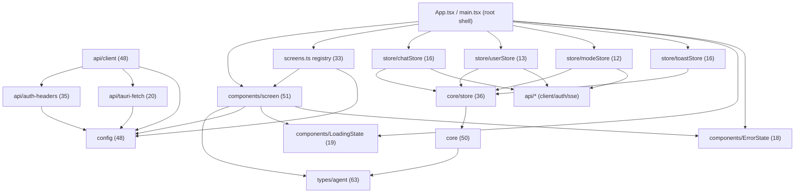

# Bloom Mode — nexustar-ui Module Dependency Map

> Research-only map of `D:/Downloads/GUI_Agent/nexustar-ui/src` (354 `.ts`/`.tsx` files).
> Purpose: locate where a root-level WebGL particle background ("Bloom mode") should attach,
> and which state/event conventions it must follow. No source files were modified.

Key facts up front:
- **State**: self-built `core/store.ts` (`create()` — zustand-v5-compatible API). No Redux. No external state lib.
- **Imports**: **100% relative**, no `@/` path alias (confirmed: 0 `@/` imports in repo).
- **Web/desktop**: Tauri is used, but the HTTP layer already degrades to native fetch in a browser. Bloom can stay pure-web.
- **WebGL**: `three` + `@react-three/fiber` + `@react-three/drei` are already dependencies (see `components/workgame/VoxelWorld.tsx`).

---

## (a) Directory → responsibility table

| Directory | Responsibility (one line) |
|---|---|
| `src/api/` | Per-domain REST client modules + the unified HTTP core (`client.ts`, `auth-headers.ts`, `tauri-fetch.ts`, `sse.ts`). The only place that talks to the backend. |
| `src/components/` | Shared UI primitives + feature component folders (see subdirs below). |
| `src/components/chat/` | **Canonical chat experience** — `ChatSection`, `ChatStream`, `Composer`, `MessageBubble`, `PlanBlock`, `ToolCard`, `ConversationList`, `SlashCommandMenu`. |
| `src/components/editor/` | Code editor surface — `CodeEditor.tsx`, `FileEditorModal.tsx` (single editor; no Monaco/CodeMirror duplicate). |
| `src/components/gome/` | GoMe workbench "cockpit" — `CockpitPanel`, `MessageStream`, `ToolCallPanel`, `GoMeBrowserPanel`, `RightPaneTabs`. |
| `src/components/music/` | Music listening UI — `Visualizer` (particles), `LyricPanel`, `PlaylistPanel`, `AudioControls`. |
| `src/components/orchestration/` | ReactFlow DAG orchestration canvas + dashboard (`OrchestrationCanvas`, `OrchestrationDashboard`, `StageIndicator`). |
| `src/components/recovery/` | Data-recovery panel (`RecoveryPanel`, embedded in GoMe right pane). |
| `src/components/screen/` | **Screen-host infrastructure** — `ScreenHost` (renders active section), `ScreenDots`, `ScreenshotStream`, `ScreenFlow`. Heavily imported (51). |
| `src/components/unified/` | Unified-shell sub-components (`RecycleBin`, `TraceRollback`). |
| `src/components/workbuddy/` | WorkBuddy / MAX immersive components (`ChatConsole`, `MaxImmersive`). |
| `src/components/workgame/` | WebGL/Three.js experiments — `VoxelWorld` (react-three-fiber). **Reference impl for Bloom.** |
| `src/components/` (root) | App shell + shared widgets: `Sidebar`, `WindowBar`, `CommandPalette`, `SplashFlow`, `ConfirmProvider`, `ErrorBoundary`, `GlassCard`, `ModeSelector`, `MaxModeBanner`, `Drawer`. |
| `src/core/` | **Self-built runtime kernel** — `store.ts` (`create`, zustand-compatible), `shu.ts` (path-subscription hub `Shu`/`useShu`), `che.ts` (intent router), `mai.ts` (resource orchestration), `instances.ts` (`appShu`/`appChe`/`appMai` singletons), `index.ts` barrel. |
| `src/hooks/` | Shared React hooks — `useFpsMonitor`, `useSplashParticles`, `useAudioParticles`, `useDebounce`, `useIntersection`, `useOrchestrationStream`. |
| `src/lib/` | Plain utilities — `platform.ts` (Tauri detection), `offlineQueue.ts`, `commandRisk.ts`, `sanitize.ts`, `slashCommands.ts`. |
| `src/screens/` | Route-level feature screens (60+): `DashboardScreen`, `MaxWorkbenchScreen`, `SwarmScreen`, `RecoveryScreen`, `MusicScreen`, `AgentScreen`, etc. + `screens.ts` registry. |
| `src/screens/swarm/` | Swarm-mode screen (`SwarmScreen`) + swarm DAG view. |
| `src/screens/_ppa/` | PPA "five-layer architecture" screens (枢·辙·脉·件·盾). |
| `src/store/` | Per-domain stores built on `core/store.ts` — `chatStore`, `modeStore`, `userStore`, `gomeStore`, `swarmStore`, `backendStore`, `toastStore`, `settingsStore`, `agentStatusStore`, `kdaContextStore`, … (38 files). |
| `src/theme/` | Theme tokens / CSS + `theme.ts` (4 themes via `<html data-theme>`). |
| `src/types/` | Shared TypeScript types. `types/agent.ts` is the single most-imported module in the repo (63 imports). |
| `src/` (root files) | `App.tsx` (shell + boot stages), `main.tsx`, `agents.ts`, `clusters.ts`, `config.ts`, `mode.ts`, `nav.ts`, `screens.ts`, `shortcuts.ts`, `shortcutsStore.ts`, `constants.ts`, `statusColors.ts`. |

---

## (b) Mermaid dependency graph (top backbone modules)

Edges = internal import relationships (relative), node size ≈ import count.



> Read: `screens` → `components` (144 edges), `screens` → `(root)` (89), `screens` → `api` (78) are the dominant flows. The store layer funnels through `core/store` → `core`; the API layer funnels through `api/client` → `api/auth-headers` / `api/tauri-fetch` → `config`.

---

## (c) Backbone modules (most-imported internal)

Count = number of files importing the module (relative imports).

| # | Module | Imports | Role |
|---|---|---|---|
| 1 | `types/agent` | 63 | Shared agent/domain types — the type hub. |
| 2 | `components/screen` | 51 | Screen-host infra (`ScreenHost`, `ScreenDots`, `ScreenshotStream`). |
| 3 | `core` (core/index) | 50 | Kernel barrel (store, shu, che, mai, instances). |
| 4 | `config` | 48 | API bases, ports, timeouts, brand, degradation constants. |
| 5 | `api/client` | 48 | Unified HTTP client (`apiGet/Post/Put/Delete`, `ApiError`). |
| 6 | `core/store` | 36 | `create()` — the store primitive every `store/*.tsx` uses. |
| 7 | `api/auth-headers` | 35 | Bearer token injection + 401 handling. |
| 8 | `screens` (screens.ts) | 33 | Screen registry (navigation SSOT). |
| 9 | `api/tauri-fetch` | 20 | Tauri-aware fetch (falls back to native fetch in browser). |
| 10 | `components/LoadingState` | 19 | Shared loading placeholder. |
| 11 | `components/ErrorState` | 18 | Shared error placeholder. |
| 12 | `store/chatStore` | 16 | Chat session/message state. |
| 13 | `store/toastStore` | 16 | Global toast notifications (`ToastRenderer`). |
| 14 | `store/userStore` | 13 | User/auth state + bootstrap. |
| 15 | `store/modeStore` / `store/gomeStore` | 12 | Work-mode state / GoMe state. |

**Takeaway for Bloom:** the architectural spine is `config` + `api/client` + `core/store` + `types/agent`. A Bloom store should sit beside `store/modeStore` and use `core/store`'s `create`.

---

## (d) Cross-directory coupling edges (top internal)

| # | Edge (src → target) | Count | Note |
|---|---|---|---|
| 1 | `screens` → `components` | 144 | Screens consume shared UI. Expected, high. |
| 2 | `screens` → `(root)` | 89 | Screens import `config`, `agents`, `nav`, `screens.ts`. |
| 3 | `screens` → `api` | 78 | Screens call backend clients directly. |
| 4 | `api` → `api` | 73 | Intra-api cohesion (client ↔ auth-headers ↔ tauri-fetch). |
| 5 | `screens` → `store` | 44 | Screens read/write domain stores. |
| 6 | `components` → `components` | 39 | Shared widget reuse. |
| 7 | `components/chat` → `components` | 36 | Chat reuses shared widgets. |
| 8 | `store` → `core` | 34 | Stores built on `core/store`. |
| 9 | `components` → `store` | 33 | Widgets subscribe to stores. |
| 10 | `store` → `api` | 33 | Stores call backend (e.g. `modeStore` posts `/mode`). |

Other notable: `api`→`(root)` 26, `screens`→`screens` 26 (swarm/_ppa), `components/chat`→`store` 23, `(root)`→`components` 20.

**Tightest mutual coupling:** `screens ↔ components ↔ store ↔ api` form a closed 4-cycle. Bloom attaches at the **root shell** (App/Workbench), so it only needs to *read* one store (`modeStore`) and touch no screen/component internals — minimal coupling risk.

---

## (e) Integration notes for the Bloom background feature

### Where to attach the canvas
- **Recommended mount point:** first child of the `app-root` `<div>` inside `Workbench` in `src/App.tsx` (lines 313–389). Mount a `<BloomBackground />` as:
  ```tsx
  <div className={`app-root${maxActive ? ' max-mode' : ''}...`}>
    <BloomBackground />   {/* NEW — position:fixed; inset:0; zIndex:0; pointer-events:none */}
    {!showUnified && <WindowBar .../>}
    ...
  </div>
  ```
  - `position: fixed; inset: 0; z-index: 0; pointer-events: none;` keeps it behind `.viewport` (which holds all UI) and above `body` background. It will not block clicks.
  - The `app-root` already receives `max-mode` / `unified-mode` classes (`App.tsx:314`), so Bloom can key intensity off those via CSS or by reading `useModeStore`.
- **Alternative (cover login + splash too):** mount inside `Root()` (`App.tsx:392`) so it persists across `selfcheck`/`onboarding`/`app`. But `SplashFlow` already paints its own `z-index:99999` overlay and `LoginScreen` has its own bg, so the simpler `app-root` mount is cleaner and avoids double-backgrounds.
- **Do NOT** put it inside `SplashFlow` — that canvas is a one-shot 2.5s 2D intro (`hooks/useSplashParticles.ts`), lifecycle is different.

### Which state / event mechanism to use
- **Read current work mode:** subscribe with selector:
  ```ts
  import { useModeStore } from '../store/modeStore';
  const mode = useModeStore((s) => s.mode); // 'office'|'plan'|'ask'|'max'|'max:auto'|'max:leader'|'build'
  ```
- **Bloom's own state (enabled / intensity / palette / paused):** add a dedicated store file `src/store/bloomStore.ts` using the project's own primitive — **not** Redux, **not** the legacy Context layer:
  ```ts
  import { create } from '../core/store';
  export const useBloomStore = create<BloomState>((set) => ({ enabled: true, intensity: 1, palette: 'auto',
    setIntensity: (n) => set({ intensity: n }), ... }));
  ```
  This matches `modeStore.tsx`, `chatStore.tsx`, `userStore.tsx` convention exactly (`create` is zustand-v5 API-compatible).
- **Event bus:** there is **no global EventEmitter**. Inter-module signals travel via stores (`getState`/`subscribe`) or SSE (`api/sse.ts`). Bloom should react to mode changes via `useModeStore` subscription, not a custom bus.

### Theme / color adaptation (critical for 4 themes)
- Themes are `dark | light | cosmic | warm`, switched by `<html data-theme="...">` (`src/theme/theme.ts`). All colors are CSS variables.
- **Read brand tokens at runtime** exactly like the existing particle engine does — `src/hooks/useSplashParticles.ts::readBrandTokens()`:
  ```ts
  const style = getComputedStyle(document.documentElement);
  const pink = style.getPropertyValue('--nx-color-cat-pink');
  const cyan = style.getPropertyValue('--nx-color-cat-cyan');
  const bg   = style.getPropertyValue('--nx-color-surface-bg');
  ```
  This makes Bloom automatically re-theme (pink/cyan/purple/blue tokens exist). Re-read on `data-theme` mutation (a `MutationObserver` on `<html>` or subscribe to the theme store).

### Performance guard (follow existing pattern)
- Reuse the FPS-degradation pattern: `src/hooks/useFpsMonitor.ts` + `SPLASH_DEGRADATION` constants in `src/config.ts` (`FPS_LOW_THRESHOLD=30`, `FPS_SKIP_THRESHOLD=20`, `CONSECUTIVE_FRAMES=3`, `PARTICLE_COUNT_FULL=220`, `PARTICLE_COUNT_HALF=110`).
- Bloom should run its own `requestAnimationFrame` loop, and on sustained <30fps halve particle count, on <20fps pause/throttle — same as `SplashFlow.tsx:382-390`.

### WebGL dependency strategy
- `three`, `@react-three/fiber`, `@react-three/drei` are already installed (`components/workgame/VoxelWorld.tsx` uses them). **Reuse them** — do not add a new 3D lib.
- Follow VoxelWorld's **lazy-load** pattern: import Bloom via `React.lazy` so three.js stays in its own chunk and is not in the initial bundle. (VoxelWorld is loaded by `UnifiedWorkbenchScreen` via `React.lazy`.)
- A raw WebGL/Canvas2D bloom is also fine and adds zero deps; the choice is Bloom's visual complexity.

### Suggested new files
- `src/components/BloomBackground.tsx` — the canvas + rAF loop (lazy-loadable).
- `src/store/bloomStore.ts` — bloom settings (uses `core/store` `create`).
- Mount `<BloomBackground />` as first child of `app-root` in `src/App.tsx`.

---

## (f) Red flags / duplication / web-vs-electron pitfalls

1. **State-mechanism fragmentation (most important).** Three coexisting mechanisms plus two more:
   - `core/store.ts` `create()` — zustand-compatible, used by all `store/*.tsx`.
   - `core/shu.ts` `Shu`/`useShu` — path-subscription hub.
   - `core/instances.ts` — `appShu`/`appChe`/`appMai` singletons, explicitly noted as the **"legacy 16-file Context+zustand hybrid, 暂不迁移"** (not yet migrated).
   - Plus React Context (`ConfirmProvider`) and local `useReducer` (`MessageBubble.tsx:463`).
   - **Action:** Bloom must use exactly ONE — the `core/store.ts` `create()` path (matches every other modern store). Avoid the legacy `instances.ts` layer and the `Shu` hub (those are for UI/intent/resource orchestration, not feature state).

2. **Tauri/desktop coupling is present but already guarded.** `api/tauri-fetch.ts`, `api/client.ts`, `lib/platform.ts`, `api/fsNative.ts`, `components/WindowBar.tsx` (desktop window controls), and `SplashFlow.tsx` (sidecar status) touch Tauri. **However** `api/client.ts`→`tauriFetch` already returns native `fetch` when `__TAURI_INTERNALS__` is absent (`api/tauri-fetch.ts:43-45`), and `lib/platform.ts::isTauri()` wraps `@tauri-apps/api` in try/catch. So a pure-browser build works.
   - **Pitfall for Bloom:** do **not** `import ... from '@tauri-apps/*'` or `api/fsNative` in Bloom code. Go through `api/client.ts` / `lib/platform.ts` if backend access is ever needed. `WindowBar` is desktop-only and irrelevant to a background.

3. **No `@/` path alias.** tsconfig has no `paths` mapping; all 354 files use relative imports. Bloom files must use relative imports too, or the build breaks.

4. **Section-convergence churn.** `App.tsx` recently collapsed `dialog/gome/work/creator/office/architect/orchestrator` into a single `unified` shell (`CHAT_SECTION='unified'`, `WorkbenchV2Screen`). `AgentScreen.tsx`/`SwarmScreen` still import the older `components/chat/ChatSection`. Expect some dead/legacy wiring — Bloom attaching only at root avoids touching any of it.

5. **Splash vs Bloom lifecycle.** `SplashFlow`'s `useSplashParticles` is a 2.5s one-shot Canvas-2D intro; Bloom is a persistent WebGL field. Keep them separate; the FPS monitor (`useFpsMonitor`) is the only piece worth sharing.

6. **Single editor, no duplicate chat editor.** Confirmed: one `CodeEditor.tsx` (no Monaco/CodeMirror). Chat is unified into `components/chat` + `unified` shell — no second chat implementation to conflict with. Good.

---

### One-line summary of method
Counts from a Python scan over all 354 `.ts/.tsx` files (relative-import resolution + bare-module classification); responsibilities from reading `App.tsx`, `core/*`, `api/client.ts`, `api/tauri-fetch.ts`, `lib/platform.ts`, `hooks/use*`, `store/modeStore.tsx`, `components/SplashFlow.tsx`, `components/workgame/VoxelWorld.tsx`, and per-dir doc comments.
