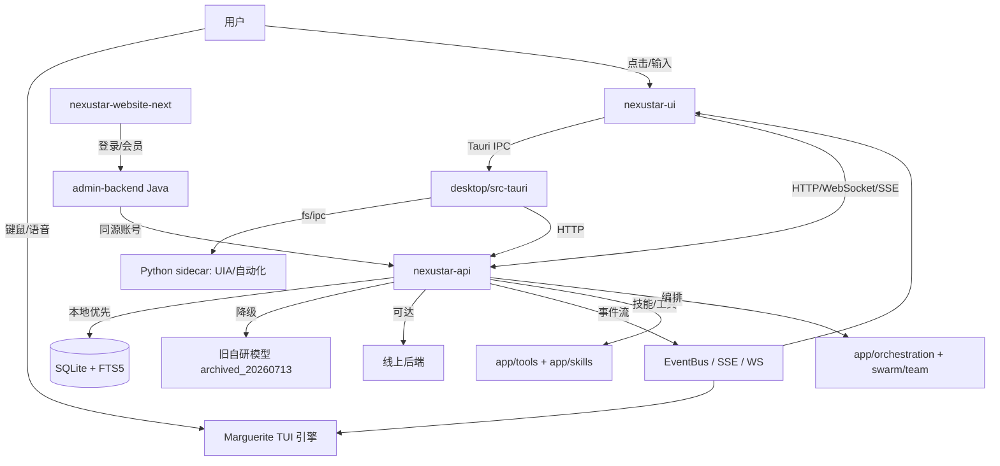

# UnivAgent 全域技术文档 v1.0（K3 全域整合文档）

> 文档类型：跨仓集成技术参考（Integration Hub）
> 受众：UnivAgent 全体研发 / 架构 / 运维 / 产品
> 生效日期：2026-08-05
> 作者：大湾区靓仔（项目总监）| 基于 Bloom 标准 v2.0 + nexustar-ui 模块图(K2.1) + 竞品深挖(K4-deep) + 战略规划 v1.0
> 状态：v1.0 草案（单一整合入口，三仓索引而非代码合并）

> ⚠️ **状态更新横幅（2026-08-07 审计）**：本文档为 2026-08-05 快照，其 **web 端状态已过时**。自 2026-08-06 web 端可逆冻结（g 期，`*.frozen-20260806/`）+ 2026-08-07 零 Web 最终决策后：(1) Marguerite 最终 GUI 为 `desktop/`（**egui** 原生 crate），非 Tauri+React；(2) `nexustar-ui`/`desktop`(Tauri)/`website`/`admin-backend`/`gwwc` 已冻结，状态应标 **frozen**；(3) 卷三 §3.2/§3.3/§7.4/§8 的 web 重架构与启动方式均已冻结。核心架构概念（36 槽 WorkbenchState / EventBus / EngineInvoker / KB 2.0 / 安全 L1-L3）仍准确。详细对账见 `docs/reconciliation-audit-report.md`。

---

## 文档定位与阅读指南

本文档是 UnivAgent 项目的**单一整合入口**：它将 `GUI_Agent`（主仓/活跃）、`_GUI_Agent_archived_20260713`（只读归档/研究参考）、`Marguerite`（TUI 引擎）三仓的能力、模块、工具、逻辑、设计与文档收口为一份结构化参考。

**与三份前置交付物的关系**（本文为它们的最终整合落点，请勿与下列文档重复阅读）：
- `bloom-mode-engineering-standard-v2.0.md`（Bloom 标准）→ 卷二/卷五/卷六的质量门禁与路线图来源
- `bloom-mode-nexustar-ui-map.md`（K2.1 模块依赖图）→ 卷三·3.2 的模块清单来源
- `bloom-mode-competitor-deepdive.md`（K4-deep 竞品深挖）→ 卷四的 adopt/avoid 来源

**三仓角色速查**：

| 仓库 | 路径 | 角色 | Git | 门禁接入点 |
|------|------|------|-----|-----------|
| Marguerite | `D:\Downloads\Marguerite\marguerite\` | TUI 引擎（Rust/ratatui） | 无 git（纯代码） | `core/src/tui/workbench` + J5 测试套件（P0 视觉门禁已落地） |
| GUI_Agent | `D:\Downloads\GUI_Agent\` | 主仓库（TS/Py/Rust/Java 全栈） | ✅ 有 git（活跃） | nexustar-ui / nexustar-api / desktop / admin-backend |
| _GUI_Agent_archived | `D:\Downloads\_GUI_Agent_archived_20260713\` | 只读归档（研究参考） | 无 git | `external/` 竞品源码供 K4 分析，不并入构建 |

> 跨仓对接靠 `docs/integration/`（规划中）+ 共享类型，不靠代码耦合。详见 Bloom 标准 §12。

---

# 卷一：产品定义

> 来源：`GUI_Agent/PRD_UnivAgent_Simple.md`（简单 PRD）+ 战略规划 v1.0 §一。

## 1.1 产品定位与愿景

| 项 | 内容 |
|----|------|
| 产品名 | `univagent`（原 GUI_Agent / GWWC） |
| 定位 | **跨形态通用 AI Agent 框架**（TUI + GUI + API + CLI 四形态统一） |
| 一句话 | 桌面端 AI 编程助手 / Universal Intelligence Vanguard |
| 核心差异化 | **TUI 原生 + 本地优先 + 跨形态唯一来源（WorkbenchState+EventBus+36 SlotId）**；不做"又一个 Cursor"，做"有 TUI 的全能 Agent" |
| 关键卖点 | 粒子音乐 Bloom 视觉（K1，竞品均无）、本地+线上双栈自动降级、账号数据隔离 |

### 三大正交目标
- **G1 协同零冗余**：单一会话内完成双模型带队与多智能体/蜂群编排，不新建独立屏幕；执行过程以可点击展开的卡片呈现。
- **G2 可靠自包含**：桌面后端采用本地+线上双栈，线上不可达时自动切换本地后端并加载旧自研模型，弱网/离线持续可用。
- **G3 安全与隔离**：用户知识库/会话/记忆严格按账号隔离（跨用户零串扰）；开源技能安装/运行前触发恶意代码纵深检测，防供应链投毒。

## 1.2 六大能力域详解

| # | 能力域 | 核心内容 | 涉及代码库 | PRD 优先级 |
|---|--------|----------|-----------|-----------|
| 1 | MAX 双带队（零冗余） | 会话内双模型带队、智能/专家团队自动编排、可展开执行卡片 | nexustar-ui + nexustar-api | P0 |
| 2 | 执行链路增强 | 推理/工具/技能/终端、开源 skills 恶意代码检测、技能自动切换 | nexustar-api | P1 |
| 3 | 账号与数据隔离 | 官网账号登录同步会员状态、按 `user_id` 知识库/会话/记忆隔离 | nexustar-api + admin-backend | P0/P1 |
| 4 | 官网 | 技术交流区（板块→帖子→评论）+ 聊天室（频道+实时）、Java 后台统管 | nexustar-website-next + admin-backend | P1/P2 |
| 5 | 桌面端后端 | 本地+线上双栈、可达性自检、自动降级加载自研模型 | nexustar-api | P0 |
| 6 | 控制面板（自研） | 一键预装/部署官网、域名绑定、备份库表、高于企业级安全防御 | control-panel（规划） | P2 |

## 1.3 用户画像与使用场景

- **独立开发者**：在单一会话内发起双模型带队、查看卡片化执行轨迹、用内置终端/浏览器自验证产出（对应能力域 1/2）。
- **团队负责人**：智能团队/专家团队会话内自动编排，无需手动指派角色（能力域 1）。
- **普通用户**：官网账号登录→同步免费/Pro 状态；知识库/会话跨账号隔离（能力域 3/4）。
- **运营**：后台统管营销/定价/支付/推送/用户（能力域 4，admin-backend）。
- **运维/安全负责人**：控制面板一键部署、备份、安全防御（能力域 6，规划中）。

## 1.4 路线图（v0.x → v1.0 → v2.0）

按 PRD Phase 0–5 与战略规划对齐：

| 阶段 | 名称 | 涉及代码库 | 关键交付 |
|------|------|-----------|----------|
| Phase 0 | 地基与可靠性切片 | nexustar-api / nexustar-ui | 双栈后端+自动切换、降级加载自研模型、按 user_id 隔离、MAX 会话骨架 |
| Phase 1 | MAX 双带队体验闭环 | nexustar-ui / nexustar-api | 自动编排、卡片展开态（各智能体状态/耗时/轨迹时间轴）、蜂群徽标 |
| Phase 2 | 执行链路增强 | nexustar-api | 推理/工具优化、技能自动切换、终端增强、开源 skills 恶意代码检测 |
| Phase 3 | 官网与账号体系打通 | nexustar-website-next / admin-backend / nexustar-api | 交流区+聊天室、Java 后台最小切片（登录/会员/库表） |
| Phase 4 | 控制面板（自研） | control-panel（新建） | 一键部署/备份/安全防御 |
| Phase 5 | 官网后台全量+智能巡检 | admin-backend（Java 全量） | 营销/支付/SMTP、会话智能巡检+自动深度安全巡查 |

> 现状锚点：TUI Workbench（Marguerite Phase A–J）已完成（79 测试全绿）；nexustar-ui ~355 文件（开发中）；nexustar-api 421 py 文件含 ~90 路由模块。

---

# 卷二：技术架构总览

## 2.1 六层架构

依赖方向**只能向下**，禁止反向引用（Bloom 标准 §4）：

```
┌──────────────────────────────────────────────────────────────┐
│ [L1] Rust TUI 引擎    core/src/tui                  │
│      WorkbenchState + EventBus + SlotId 契约（跨形态唯一来源） │
│      ↑ bridge（文档 + 共享类型，禁止逻辑耦合）                  │
├──────────────────────────────────────────────────────────────┤
│ [L2] TS 桌面 GUI       nexustar-ui                            │
│      pages→layouts→features(按域)→shared(ui/hooks/utils/store/theme)→lib │
│      ↑ Tauri IPC                                         │
├──────────────────────────────────────────────────────────────┤
│ [L3] Rust 桌面壳        desktop/src-tauri                     │
│      sidecar / 文件网关 / UIA 桥                              │
│      ↑ HTTP/gRPC/OpenAPI                                │
├──────────────────────────────────────────────────────────────┤
│ [L4] Py API 后端        nexustar-api                          │
│      app/routers→services→repositories→domain→infra          │
├──────────────────────────────────────────────────────────────┤
│ [L5] 官网                nexustar-website(-next)               │
│ [L6] 控制面板/管理后台   admin-backend(Java SpringBoot)        │
└──────────────────────────────────────────────────────────────┘
```

**分层约束**：
- `shared/components/ui` 不得反向依赖 `features/`；`utils/` 纯函数不得引 React/DOM/API。
- TUI 与 GUI 通过 **WorkbenchState + EventBus + 36 槽 SlotId** 对接（Phase J 已锁定，GUI 直接消费，无需返工）。
- 三层（Web/Desktop/CLI）是同一后端的状态无关客户端（借鉴 openclaw gateway/runtime 拆分，见卷四）。

## 2.2 跨形态唯一来源（WorkbenchState + EventBus + 36 SlotId）

来自 `Marguerite/core/src/tui/workbench/` 与 `core/src/events/`：

- **WorkbenchState**（`workbench/state.rs`）：全局视图模型 + 单向归约核心。所有外部刺激（按键/事件总线/定时器/审批）统一为 `UiEvent`，经 `WorkbenchState::reduce` 产生视图变更（直接改 state）与副作用（`UiEffect`）。State 为不可变快照，渲染只读。
  - 交互状态机 `InteractionState`：`Idle / Processing / AwaitingApproval / Done / Repairing / Interrupting`（B4 一致性门禁）。
  - 主区 Tab `MainTab`：`Chat / Code / Terminal`；右栏 AI 面板独立 Tab 集。
- **EventBus**（`events/bus.rs`）：主题订阅 + 通配匹配（`agent.*`、`ws.**`、`**`）+ 历史回放缓冲（LRU，默认上限 2000）。路由键 `{session}.{type}`。
- **SlotId**（`workbench/slot.rs`）：**36 槽注册表**，跨形态契约唯一来源。包含文档枚举的 20 个 + 实际存在的 16 个表面，分四区：

| 区 | 数量 | 槽位（SlotId） |
|----|------|----------------|
| 左（活动栏+侧边栏） | 10 | LeftActivity, LeftSidebarFileTree, LeftSidebarSearch, LeftSidebarSkills, LeftSidebarSessions, LeftSidebarCommands, LeftSidebarGit, LeftSidebarProblems, LeftSidebarOutline, LeftSidebarBookmarks |
| 中（工作区） | 10 | MainTabs, MainChat, MainCode, MainTerminal, MainDiff, MainPreview, MainDebug, MainProblems, MainSearch, MainCallStack |
| 右（AI 面板） | 10 | RightChat, RightAgentStatus, RightAgentTools, RightAgentContext, RightAgentMemory, RightAgentTasks, RightAgentPlanner, RightAgentTrace, RightAgentLogs, RightAgentEval |
| 底（状态/输出） | 6 | BottomTerminal, BottomProblems, BottomStatusbar, BottomOutput, BottomDebugConsole, BottomPorts |

- 插槽四态 `SlotState`：`Loading / Empty / Error / Content`（三态内联，错误内联红，绝不冒泡）。
- 任一 `Slot` 实现 trait：`id() -> SlotId` + `render(frame, area, &WorkbenchState)`。**TUI 渲染子集，CLI/GUI 渲染其余，三者共享同一 SlotId。**

## 2.3 技术栈锁定表（版本锚定）

| 层 | 技术 | 版本锚定 | 来源/依据 |
|----|------|----------|-----------|
| TUI 引擎 | Rust + ratatui + crossterm | 仓内锁定（Cargo.lock） | Marguerite |
| 桌面壳 | Rust + Tauri 2.x | `desktop/src-tauri/tauri.conf.json` | desktop |
| 桌面前端 | React + TypeScript + Vite | 经 `tsconfig` strict | nexustar-ui |
| 桌面 WebGL | three + @react-three/fiber + @react-three/drei | 已安装（VoxelWorld 引用） | nexustar-ui |
| 状态管理 | 自研 `core/store`（`create`，zustand-v5 兼容） | 无 Redux/外部库 | nexustar-ui |
| HTTP 客户端 | 自研 `api/client` + Tauri-aware fetch | 浏览器降级 native fetch | nexustar-ui |
| 后端 | Python + FastAPI + SQLite（FTS5） | 仓内锁定 | nexustar-api |
| 后端侧车 | Python sidecar（UIA/自动化） | `desktop/sidecar/` | desktop |
| 官网 v1 | Vite + TS + Tailwind | nexustar-website | 官网站 |
| 官网 v2 | Next.js（App Router） | nexustar-website-next | 官网站 |
| 管理后台 | Java + SpringBoot | `admin-backend/src/main` | admin-backend |
| 控制面板 | 规划中（自研 Web 服务） | — | PRD Phase 4 |

> Bloom 视觉门禁 V3：颜色/间距/字号一律 Design Token 引用，禁止硬编码（例外 `#fff`/`#000`）。品牌蓝锚定 `#3B82F6`。

## 2.4 数据流架构图



---

# 卷三：功能模块清单与状态

> 状态图例：✅ done（已落地）/ ⚠️ in-progress（开发中）/ 📋 planned（规划）。
> 标注 `[active]` 来自 GUI_Agent，标注 `[archived]` 来自只读归档，标注 `[marg]` 来自 Marguerite。

## 3.1 TUI Workbench（Marguerite，Phase A–J 完成）

| 模块 | 路径 | 状态 | 说明 |
|------|------|------|------|
| Workbench 布局 | `core/src/tui/workbench/layout.rs` | ✅ | 三栏+底栏计算、折叠态 |
| 36 槽注册表 | `core/src/tui/workbench/slot.rs` | ✅ | SlotId 枚举 + Slot trait |
| 全局状态 | `core/src/tui/workbench/state.rs` | ✅ | WorkbenchState + reduce + UiEvent/UiEffect |
| 命令面板 | `core/src/tui/workbench/command.rs` | ✅ | slash/快捷命令 |
| 输入/组合器 | `core/src/tui/workbench/input.rs` | ✅ | Composer（流式输入） |
| 快捷键 | `core/src/tui/workbench/shortcut.rs` | ✅ | 全局快捷键 |
| 注册表 | `core/src/tui/workbench/registry.rs` | ✅ | 槽位渲染注册 |
| 主题 | `core/src/tui/workbench/theme.rs` | ✅ | 终端主题 |
| 工作区监听 | `core/src/tui/workbench/workspace_watcher.rs` | ✅ | 文件变更 |
| 事件总线 | `core/src/events/bus.rs` + `envelope.rs` | ✅ | 主题订阅+回放缓冲 |
| Agent 运行时 | `core/src/agent/runtime.rs` + `subagent.rs` | ✅ | 引擎↔UI 通道 |
| 模式 | `core/src/mode/mod.rs` | ✅ | ModeKind |
| J5 测试套件 | `core/src/tui/workbench/` 测试 | ✅ | P0 视觉门禁已落地 |

> 全部 79 测试通过（Phase J 收口）。TUI 通过 WorkbenchState+EventBus+SlotId 与 GUI 对齐。

## 3.2 Desktop GUI（nexustar-ui + Tauri）[active]

来自 K2.1 模块依赖图（355 个 `.ts/.tsx` 文件，100% 相对导入，无 `@/` 别名）：

| 模块 | 路径 | 状态 | 说明 |
|------|------|------|------|
| App 壳/启动 | `src/App.tsx` + `main.tsx` | ⚠️ | 多阶段 boot；unified 壳收敛 |
| 自研内核 | `src/core/`（`store.ts`/`shu.ts`/`che.ts`/`mai.ts`/`instances.ts`） | ⚠️ | 三种状态机制并存（需治理，见卷九） |
| HTTP 核心 | `src/api/`（`client.ts`/`auth-headers.ts`/`tauri-fetch.ts`/`sse.ts`） | ⚠️ | 唯一后端入口 |
| 聊天体验 | `src/components/chat/` | ⚠️ | ChatSection/Stream/PlanBlock/ToolCard 等 |
| GoMe 工作台 | `src/components/gome/` | ⚠️ | CockpitPanel/ToolCallPanel/BrowserPanel |
| 音乐 | `src/components/music/` | ⚠️ | Visualizer(粒子)/Lyric/Playlist/AudioControls |
| 编排画布 | `src/components/orchestration/` | ⚠️ | ReactFlow DAG + Dashboard |
| 屏幕宿主 | `src/components/screen/` | ⚠️ | ScreenHost/ScreenDots/ScreenshotStream（51 引用） |
| WebGL 实验 | `src/components/workgame/VoxelWorld.tsx` | ⚠️ | three/R3F 参考实现（Bloom 复用） |
| 屏幕（60+） | `src/screens/` | ⚠️ | MaxWorkbench/GoMe/Swarm/Recovery/Music/Agent… |
| 领域 store（38） | `src/store/` | ⚠️ | chatStore/modeStore/gomeStore/swarmStore… |
| 主题 | `src/theme/` | ⚠️ | 4 主题（dark/light/cosmic/warm）via `data-theme` |
| 类型枢纽 | `src/types/agent.ts` | ✅ | 全仓最高引用（63） |
| Bloom 背景（新增） | `src/components/BloomBackground.tsx` + `src/store/bloomStore.ts` | 📋 | K1.4，挂载 app-root 首子节点（见卷五） |

**骨架模块（最高引用）**：`types/agent`(63) > `components/screen`(51) > `core`(50) > `config`(48) > `api/client`(48) > `core/store`(36) > `api/auth-headers`(35) > `screens.ts`(33)。

**屏幕宿主架构（unified 收敛）**：近期 `App.tsx` 将 `dialog/gome/work/creator/office/architect/orchestrator` 收敛为单一 `unified` 壳（`WorkbenchV2Screen`）；`AgentScreen`/`SwarmScreen` 仍引用旧 `components/chat/ChatSection`，存在遗留接线（见卷九）。

## 3.3 API 后端（nexustar-api FastAPI）[active]

421 个 `.py` 文件，`app/` 分层：routers → services → repositories → domain → infra。

| 子模块 | 路径 | 状态 | 关键内容 |
|--------|------|------|----------|
| 认证 | `app/routers/auth.py` | ⚠️ | 登录/注册/refresh/device-login/登出/网站同步 |
| 双栈切换 | `app/routers/backend_switch.py` + `app/backend_switcher.py` | ⚠️ | online/local 切换（P0-1/P0-2） |
| 会话/聊天 | `app/routers/sessions.py` + `chat.py` + `chat_ws.py` | ⚠️ | SSE/WS 流式 |
| MAX 双带队 | `app/routers/max_dual_leader.py` | ⚠️ | 会话内双模型带队 |
| 编排 | `app/routers/orchestrator.py` + `app/orchestration/` | ⚠️ | 多智能体/蜂群 |
| 团队/蜂群 | `app/routers/team.py` + `subagents.py` | ⚠️ | 团队编排、子代理 |
| 工具 | `app/tools/`（40+ 文件） | ⚠️ | exec/browser/file/terminal/research/rollback… |
| 技能 | `app/skills/`（13 JSON manifest + scanner.py） | ⚠️ | 技能清单 + 扫描 |
| 技能市场 | `app/routers/skills_market.py` + `skills_marketplace.py` | 📋 | 分发/版本 |
| 记忆（分层） | `app/routers/memory_layers.py` + `four_layer_memory.py` + `project_memory.py` | ⚠️ | 多层记忆 |
| 知识库 | `app/routers/kb.py` + `cloud_kb.py` | ⚠️ | RAG/向量 |
| ACP | `app/routers/acp.py` + `app/acp/` | ⚠️ | Agent-Client-Protocol |
| 自动化 | `app/routers/automations.py` + `app/tools/control_tool.py` | 📋 | 录制/回放（UIA 桥） |
| 桌面/终端 | `app/routers/desktop.py` + `terminal.py` | ⚠️ | 终端指令 |
| 浏览器 | `app/routers/browser.py` + `app/tools/browser*.py` | 📋 | 内置浏览器（Headless+有头） |
| 安全/权限 | `app/routers/security.py` + `permissions.py` + `antihallucination.py` | ⚠️ | 恶意代码检测（P1-2，规划中） |
| 恢复/快照 | `app/routers/recovery.py` + `app/recovery/` | ⚠️ | 回滚/检查点 |
| 可观测 | `app/routers/observability.py` + `events.py` | ⚠️ | 事件总线/监控 |
| 本地模型 | `app/routers/local_providers.py` + `app/tools/local_providers.py` | ⚠️ | 降级加载自研模型 |
| 健康检查 | `app/routers/health.py` + `doctor.py` | ✅ | 可达性自检 |

> 路由模块约 90 个（`app/routers/*.py` 全量见卷七 §7.1）。

## 3.4 官网（nexustar-website / -next）[active]

| 模块 | 路径 | 状态 | 说明 |
|------|------|------|------|
| 官网 v1 | `nexustar-website/`（Vite+TS+Tailwind） | ⚠️ | 含 README-ARCHIVED，部分遗留 |
| 官网 v2 | `nexustar-website-next/`（Next.js App Router） | ⚠️ | 交流区/聊天室前端（P1-3） |
| 组件 | `nexustar-website-next/components` + `app` | ⚠️ | 首页/交流区/聊天室/会员中心 |

## 3.5 管理后台（admin-backend，Java SpringBoot）[active]

| 模块 | 路径 | 状态 | 说明 |
|------|------|------|------|
| 主程序 | `admin-backend/src/main` | 📋 | 登录注册/会员定价/库表管理（P1-4 最小切片） |
| 测试 | `admin-backend/src/test` | 📋 | 单元测试（maven-surefire） |
| 全量后台 | 同仓 | 📋 | 营销/支付/SMTP（P2-2） |

> Java 后台为新建系统；PRD 待确认是否已有仓库（见 PRD §6 待确认 #3）。

## 3.6 控制面板（规划中）

| 模块 | 路径 | 状态 | 说明 |
|------|------|------|------|
| 控制面板 | 规划（新建 Web 服务） | 📋 | 一键预装/部署官网/绑定域名/备份库表/安全防御（P2-1） |
| UIA 桥 | `desktop/sidecar/` + `app/tools/control_tool.py` | ⚠️ | 桌面操控/自动化引擎（C 阶段） |

> 控制面板与桌面端关系待确认：独立 Web 服务 vs 桌面内置模块（PRD §6 待确认 #8）。
> 安全防御"高于宝塔企业级"具体指 WAF/入侵检测/防刷，待确认。

---

# 卷四：竞品能力矩阵

> 来源：K4-deep 竞品深挖（openclaw/hermes/deepseek-tui + Cline/OpenHands）+ 战略规划 v1.0 §四。

## 4.1 IDE 类竞品对比（截图竞品）

| 产品 | 公司 | 自主性 | 定价 | 核心差异化 |
|------|------|--------|------|------------|
| Cursor | Cursor Inc. | L2 任务级 | $20/mo | Tab 补全标杆 + Composer 多文件 |
| Trae CN / TRAE SOLO | 字节跳动 | **L4 系统级** | 免费/$100 SOLO | 中文原生 + Solo 全流程自动化 |
| Qoder | 阿里 | L3 模块级 | 免费/付费 | 10 万文件上下文 + Wiki |
| Kiro | Amazon | L2–L3 | $20/mo | Spec&Hooks + Claude 4.5 |
| CodeBuddy | 腾讯云 | L3 | ¥198/人/月 | 全链路（PRD→部署）+ Craft |
| 元宝 | 字节 | L? | 免费 | 通用助手（非专用 IDE） |

## 4.2 Agent 框架对比

| 维度 | OpenClaw | Hermes Agent | DeepSeek-TUI | **UnivAgent(目标)** |
|------|----------|-------------|--------------|---------------------|
| 语言 | TypeScript | Python | Rust | **Rust(TUI)+TS(GUI)+Py(API)** |
| 架构 | Gateway+4 Runtime | 单循环+学习闭环 | TUI+MCP | **TUI+GUI+API+CLI** |
| 记忆 | MEMORY.md+向量 | 5 层+FTS5 | 会话级 | **三层(会话/持久/元记忆)** |
| Skill | ClawHub 13K+ | Auto-gen | 插件式 | **WorkBuddy Skill** |
| 多模型 | 15+ Provider | 15+ | DeepSeek 系列 | **多模型+本地优先** |
| GUI | 无 | 无 | **TUI 原生** | **TUI(Ratatui)+GUI(Tauri)** |
| 桌面操控 | 工具调用 | 工具调用 | 无 | **UIA+RPA（规划）** |
| 粒子/音频 | 无 | 无 | 无 | **Bloom 粒子音乐（差异化）** |

## 4.3 差距分析与应对策略

| 能力域 | 竞品均值 | UnivAgent 现状 | 差距 | 优先级 | 应对策略 |
|--------|---------|---------------|------|--------|----------|
| TUI 原生 | DeepSeek-TUI 有 | **Phase J 已完成（79 测试绿）** | ✅ 领先 | N/A | 巩固门禁 |
| GUI 桌面 | Cursor/Trae 成熟 | nexustar-ui 355 文件（开发中） | ⚠️ 60% | P0 | 收敛 unified 壳 + Bloom |
| 内置终端 | Warp/Cursor 有 | 无 | ❌ | P1 | 内置沙箱终端（卷六 6.1） |
| 内置浏览器 | 少数有 | 无 | ❌ | P1 | Headless+有头（卷六 6.2） |
| 多模型编排 | OpenClaw/Hermes 成熟 | 双模型(MAX)基础在 | ⚠️ 40% | P0 | 编排+fallback 链 |
| 技能生态 | ClawHub 13K+ | WorkBuddy Skills | ⚠️ | P1 | 技能市场+版本化 |
| 记忆系统 | Hermes 5 层 | 分层记忆在 | ⚠️ | P1 | 强化多层记忆 |
| 音频/粒子 | 无 | **K1 规划（差异化）** | ✅ 将领先 | P0 | Bloom+粒子音乐 |
| 桌面操控/UIA | 无 | 规划中（C 阶段） | ⚠️ 早期 | P2 | RPA 引擎（卷六 6.3/6.4） |
| 离线能力 | Hermes 本地优先 | 本地+线上双栈 | ✅ | N/A | 保持 |
| 部署/运维 | OpenClaw 托管 | 控制面板（自研） | ✅ | N/A | 差异化 |

### Adopt / Avoid（写入门禁）

**ADOPT**（来自 K4-deep）：
- Cline：Plan/Act 分离 + 审批门 + `.rules` 编码标准 + MCP 市场 + 内置浏览器/终端沙箱。
- OpenHands：Docker 沙箱 + 事件流 + 插件系统 + 多 agent 协作。
- Hermes：五层记忆 + 自进化闭环（技能自动生成）。
- OpenClaw：Gateway+多 Runtime 插件化 + ClawHub 技能生态（轻量 bridge 化）。
- Aural-Pro：GPU 卸载粒子（80K–200K）+ UnrealBloom。
- deepseek-tui：TUI 流式渲染 + mpsc 通道解耦（直接竞品参照）。

**AVOID**：
- 纯审批流在超大多文件任务偏慢（用并行子 agent 缓解）。
- 循环/回退敏感（需 Plan 门禁兜底）。
- 单循环无沙箱（用本地优先+沙箱补）。
- 仓库过重（走轻量 bridge，不 fork 全部 vendor 集成）。

---

# 卷五：Bloom 模式与粒子系统

> 来源：K1 视频分析（战略规划 §2）+ Bloom 标准 §5/§7 + K2.1 集成笔记（e 节）。

## 5.1 特效参数规范

从逐帧分析（F01→F21，雏菊→粒子星云）反推的核心参数（`BLOOM_CONFIG`）：

| 参数 | 取值 | 映射 |
|------|------|------|
| particleCount | 3000–20000（渐增） | 会话启动→背景弥散 |
| lifespan | 3.0–8.0s | — |
| gravity | vec3(0,-0.02,0) | 花瓣飘落感 |
| turbulence | 0.003 | Simplex 噪声频率 |
| damping | 0.98 | 速度衰减 |
| dissolveRate | 0.15/s | F01→F10 溶解比例 |
| bloom.strength | 1.8 | UnrealBloomPass |
| bloom.radius | 0.6 | 扩散半径 |
| bloom.threshold | 0.2 | 亮度阈值 |
| background | vec3(0,0,0) | 纯黑底 |

**色彩映射**（视频实际色值）：petal `#F2F2F2`、center `#FFD800`、particleA `#66D9E6`(青)、particleB `#99CC33`(黄绿)、sparkle `#B3E6FF`(冰蓝)。

## 5.2 状态机设计

```
[IDLE] ──(用户发消息)──▶ [SOLID_APPEAR] ──(0-3s)──▶ [DISSOLVE]
                                                    │(3-10s)
                                                    ▼
                                             [PARTICLE_BLOOM] ◀──(音频驱动)──▶ [AudioReactive]
                                                    │(10-18s)
                                                    ▼
                                             [DISPERSE] ──(18s+)──▶ [IDLE_BACKGROUND]
```

会话生命周期映射：F01 消息到达 → SOLID_APPEAR；AI 思考中 → DISSOLVE；回复生成高潮 → PARTICLE_BLOOM；过渡 idle → DISPERSE；背景持续态 → IDLE_BACKGROUND。

## 5.3 音频分析管线

```
本地文件/URL → AudioContext.decodeAudioData() → AnalyserNode.fftSize=2048
                ┌────────────┼────────────┐
                ↓            ↓            ↓
         LOW(0-60Hz)    MID(250-2K)   HIGH(2K+)
         径向爆发        涡流扭矩       高频微颤
      particle.scale  particle.rot   particle.twinkle
```

**歌词获取策略**：网易云（`/song/media/outer/url?id=` 无需登录 ★★★★☆）/ QQ 音乐（需 Cookie ★★★☆☆）/ 酷我（搜索 API ★★★☆☆）/ 本地 LRC（★★★★★ 最佳）。

**参考开源**（已验证）：Y2K PARTICLE CORE(36K 分频+手势)、carthworks/audio-visualizer(Cinematic+Beat)、shader-playground(R3F+8-band FFT，技术栈最匹配)、Aural-Pro(80–200K GLSL+Nuclear Boost)。

## 5.4 集成架构

```
nexustar-ui (React/Tauri WebView)
└── src/components/BloomBackground.tsx   ← 新增（K1.4）
    ├── Three.js Scene (WebGL Canvas, zIndex:0, pointer-events:none)
    ├── ParticleSystem (GLSL Vertex)
    ├── AudioAnalyzer (Web Audio API)
    └── BloomStateMachine
事件源（经 store 订阅，非自定义 bus）：
  modeStore.mode 变化 → 强度切换
  EventBus: "message:sent"   → SOLID_APPEAR
  EventBus: "ai:thinking"    → DISSOLVE
  EventBus: "ai:response"    → PARTICLE_BLOOM
  EventBus: "audio:playing"  → AudioReactive
```

**挂载点**（`K2.1 e`）：`app-root` `<div>` 首子节点，`position:fixed; inset:0; z-index:0; pointer-events:none`。读取 `modeStore` 与 `<html data-theme>` 品牌 token（`--nx-color-cat-pink/cyan/...`），复用 `useFpsMonitor` + `config` 降级常量（FPS_LOW=30 / SKIP=20）。WebGL 依赖复用现有 `three/@react-three/fiber`，经 `React.lazy` 独立 chunk。

**新增文件**：`src/components/BloomBackground.tsx` + `src/store/bloomStore.ts`（用 `core/store` 的 `create`，**不**引 legacy `instances.ts`/`Shu` 中枢）。

---

# 卷六：内置工具与应用路线图

> 来源：Bloom 标准 §11（闭环自验证）。

为"更高质产物"，UnivAgent 内置工具必须支持 agent 自己验证产出。所有工具走 MCP 或 Tauri IPC，权限按需申请、操作可审计（沿用 Cline 审批门）。

| 工具 | 形态 | 参考 | 优先级 | 状态 |
|------|------|------|--------|------|
| 沙箱终端 | 内嵌 xterm.js / 自研，跑测试/构建/命令读 stderr | Cline/Cursor | P0 | 📋 规划（对应 `app/routers/terminal.py`） |
| 内置浏览器 | Headless(Puppeteer)+有头双模，截图验证 UI 变更 | Cline | P0 | 📋 规划（`app/routers/browser.py` + `app/tools/browser*.py`） |
| 自动化引擎 | 无视觉鼠标操控（坐标/语义定位）+ 第三方 RPA 桥 | OpenHands/UIA | P1 | ⚠️ 部分（`desktop/sidecar` + `control_tool.py`） |
| 文件网关 | 本地文件读写/检索/收藏（歌曲/文档） | — | P1 | ⚠️ 部分（Tauri `fs_*` IPC + `app/routers/files.py`） |
| 粒子音乐 | 音频解析+歌词获取+FFT 驱动 Bloom 背景 | K1/Aural-Pro | P0(差异化) | 📋 K1.2 原型进行中 |

### 6.1 内置沙箱终端（Warp-like）
- 目标：agent 在会话内跑 `pytest`/`build` 并读 stderr 自验证。
- 现状：后端已有 `app/routers/terminal.py` + `app/tools/terminal.py` 指令执行能力；GUI 侧 `terminalStore.tsx` 已存在。
- 风险：需 OS 级沙箱（Landlock/Seatbelt，借鉴 deepseek-tui），非纯 denylist（避免 hermes 反模式）。

### 6.2 内置浏览器（Headless + 有头双模）
- 目标：截图验证 UI 变更，闭环自验证。
- 现状：后端 `browser.py` + `browser_a11y.py` + `browser_session.py` 已搭骨架；前端 `browserStore.tsx` + `components/gome/GoMeBrowserPanel` 已存在。
- 形态：默认 Headless 截图，用户需可视化时切有头。

### 6.3 自动化引擎（无视觉鼠标操控）
- 目标：坐标/语义定位驱动桌面操作，配第三方 RPA 软件桥。
- 现状：`desktop/sidecar/`（Python UIA 桥）+ `app/tools/control_tool.py` + `control_recorder.py` 提供录制/回放（前端 `ControlRecorderPanel`/`ControlReplayPanel`）。

### 6.4 RPA 框架（第三方软件操控）
- 目标：操控第三方桌面软件（C 阶段，P2）。
- 现状：UIA 桥雏形在 `desktop/sidecar/uia_ingest`；`SecurityScanBadge`/`ControlRecorderPanel` 已挂前端。
- 风险：需审批门 + 操作审计 + 最小权限。

---

# 卷七：API 契约索引

## 7.1 nexustar-api 端点清单（样本真实路由）

> 从 `app/routers/*.py` 提取的真实路由装饰器（约 90 路由模块）。完整清单见 `nexustar-api` 源码。

**认证（auth.py）**：`POST /api/v1/auth/login`、`/register`、`/register-sync`、`/sync-website`、`/device-login`、`/logout`、`/logout-all`、`/change-password`、`PATCH /api/v1/me`

**双栈切换（backend_switch.py）**：`POST /switch/online`、`POST /switch/local`、`GET /models/local`、`POST /models/load`

**会话/聊天**：`POST /api/v1/chat`、`WS /api/v1/ws/chat`、`GET /events`、`GET /events/{sequence_id}`、`POST /{session_id}/restore`、`POST /{session_id}/rollback/{checkpoint_id}`

**MAX/编排/团队（max_dual_leader/orchestrator/team/subagents）**：编排 spawn/sequence 路由、`GET /registry`、`GET /pending`、`POST /spawn`、`POST /sequence`、`GET /sequence/{sequence_id}`

**桌面/自动化（desktop/automations/control）**：`POST /window/list`、`/window/focus`、`/app/launch`、`/open`、`/close`、`/screenshot`、`/input/click`、`/input/type`、`/clipboard/read`、`/clipboard/write`、`/detect`、`/navigate`、`/trigger`、`/{automation_id}/run`、`/verify`、`/verify-tool`

**安全/审批（security/permissions/gate）**：`POST /gate/check`、`/gate/block-log`、`/act`、`/derive-criteria`、`/time-pressure/check`、`/placation/check`、`GET /verifiers`

**文件/终端（files/terminal/exec）**：`PUT /vars/{key}`、`GET /vars`、`POST /execute`、`POST /jsonrpc`

**知识库/记忆（kb/cloud_kb/memory_layers）**：KB 增删查、多层记忆读写

**健康检查**：`GET /health`、`GET /status`

> 统一响应信封 `{code,message,data,traceId,timestamp}`（Bloom 标准 §5）；非零 code 前端抛 `BusinessError`。

## 7.2 EventBus 事件目录（Marguerite）[marg]

`core/src/events/envelope.rs` 定义的 10 种 `EventType`（snake_case 主题段）：

| 类型 | 主题段 | 说明 |
|------|--------|------|
| Thinking | `thinking` | 模型思考片段 |
| ToolCall | `tool_call` | 工具调用请求 |
| ToolResult | `tool_result` | 工具返回 |
| Plan | `plan` | 计划/链结构 |
| Approval | `approval` | 审批请求/结果 |
| Progress | `progress` | 进度播报 |
| MemoryRef | `memory_ref` | 记忆台账引用 |
| Error | `error` | 错误 |
| Done | `done` | 完成 |
| Status | `status` | 状态变更（模式切换等） |

事件信封 `Envelope{version, route_key={session}.{type}, payload}`；支持前向兼容（`v` 超当前版本 → `UnsupportedVersion` 忽略并告警）。前端经 SSE（`src/api/sse.ts`）消费等价事件流。

## 7.3 SlotId 槽位定义（36 槽）[marg]

见卷二 §2.2 四区表（左10/中10/右10/底6）。TUI 渲染子集，CLI/GUI 渲染其余，三者共享同一 `SlotId`。

## 7.4 Tauri IPC 契约（desktop/src-tauri）[active]

`src-tauri/src/*.rs` 中 `#[tauri::command]` 共 10 组（实际导出命令函数名如下）：

**文件网关（fs_*）**：`fs_list` / `fs_read_text` / `fs_write_text` / `fs_create` / `fs_delete` / `fs_rename` / `open_file_local` / `reveal_in_folder` / `resolve_path` / `infer_workspace_dir`

**外部/桌面**：`open_external_desktop` / `get_device_token`

**侧车管理（sidecar）**：`sidecar_launch` / `spawn_sidecar` / `kill_sidecar` / `wait_backend_ready` / `health_url` / `health_timeout` / `generate_sidecar_token` / `verify_sidecar_token`

**调试/托盘**：`record_debug` / `build_tray` / `load` / `validate`

> 所有命令经 capability 权限文件（`src-tauri/capabilities/`）按需授权；Bloom 组件**禁止**直接 `import '@tauri-apps/*'` 或 `api/fsNative`，须经 `api/client`/`lib/platform.ts`（K2.1 红线）。

---

# 卷八：部署与运维

## 8.1 本地开发环境

| 组件 | 启动方式 | 路径/脚本 |
|------|----------|-----------|
| 前端 | Vite dev | `nexustar-ui`（`start-dev.ps1` 存在） |
| 后端 | uvicorn/FastAPI | `nexustar-api/run_server.py`；`selftest.py` 自检 |
| 桌面壳 | Tauri dev | `desktop/src-tauri`（`tauri.conf.json`） |
| 侧车 | Python sidecar | `desktop/sidecar/`（端口 18181，见 `sidecar_18181.log`） |
| 官网 v2 | Next.js dev | `nexustar-website-next`（端口 3000） |
| 管理后台 | SpringBoot | `admin-backend/src/main`（`mvn` 构建） |

> 双栈自检：后端 `doctor.py` + `app/routers/health.py` 提供可达性探针；线上不可达自动切本地（backend_switcher）。

## 8.2 构建流水线

- 前端：`nexustar-ui` Vite 构建（TS strict 卡点）；`nexustar-website` 同栈。
- 后端：`nexustar-api` 经 ruff + pytest（`.ruff_cache`/`.pytest_cache` 存在）；`.test-reports` 产出。
- 桌面：`desktop/` Tauri 构建（`tauri_build*.log` 记录）；sidecar 经 PyInstaller（`sidecar/build*`）。
- 官网：`nexustar-website-next` Next.js 构建。
- 后台：`admin-backend` Maven 构建（`target/`）。
- CI 门禁（Bloom 标准 §2）：L1 pre-commit → L2 CI 静态(Sonar/ESLint/Stylelint/Lighthouse/Gitleaks) → L3 测试 → L4 设计评审 → L5 发布。

## 8.3 控制面板操作手册（规划）

> 对应 PRD P2-1，当前为规划态。预期能力：
- 一键预装环境、部署官网、绑定域名
- 备份库表 + 数据恢复（见 `rebuild_*.log`/`sidecar_build*.log` 历史产物）
- GitHub 分支链接更新、日志管控、前后端启停
- 安全防御（高于企业级：WAF/入侵检测/防刷，待确认）

## 8.4 监控与告警

- 后端：`app/routers/observability.py` 提供可观测端点；`events.py` 事件流。
- 前端：`src/components/ObservabilityScreen.tsx` + `HeartbeatLog.tsx`（后端心跳日志）。
- 运行日志：`GUI_Agent/backend_*.log`、`sidecar_18181*.log`、`desktop/sidecar/logs/`。
- 安全：`app/routers/security.py` + 前端 `SecurityCenterScreen.tsx` + `SecurityScanBadge.tsx`。

---

# 卷九：已知遗留项与债务清单

## 9.1 技术债务

1. **前端状态机制碎片化**（K2.1 f-1，P0）：`core/store`(create) + `core/shu`(Shu/useShu) + `core/instances`(legacy 16 文件 Context+zustand 混合，暂不迁移) + React Context + useReducer 五种并存。Bloom 等新增功能必须只用 `core/store` 的 `create`，避免 legacy 层。
2. **unified 壳收敛遗留接线**（K2.1 f-4）：`App.tsx` 收敛为 `unified` 壳后，`AgentScreen`/`SwarmScreen` 仍引旧 `components/chat/ChatSection`，存在死/遗留代码。
3. **无 `@/` 别名**（K2.1 f-3）：355 文件全相对导入，新增文件须遵循，否则构建断。
4. **单文件巨模块反模式**（hermes 教训）：后端 `run_server.py`/`selftest.py` 等顶层脚本混杂测试与启动逻辑，建议拆分（Bloom 标准 R1 红线）。
5. **Tauri/桌面耦合已守卫但仍需警惕**（K2.1 f-2）：Bloom 禁止直引 `@tauri-apps/*`/`api/fsNative`。

## 9.2 功能缺口

- 内置终端/浏览器/RPA 仍为规划/雏形（卷六），未达 Warp/Cursor 成熟度（卷四 4.3）。
- 技能市场分发/版本化未落地（ClawHub 式，待做）。
- 控制面板全功能未实现（P2-1）。
- 官网后台全量（营销/支付/SMTP）未实现（P2-2）。
- MAX 高级编排细粒度可视化/蜂群回放未做（P2-3）。
- 恶意代码检测引擎选型未定（PRD 待确认 #4：ClamAV/正则+YARA/自研）。

## 9.3 测试覆盖不足

- 前端：`swarmStore.test.tsx` 等少数单测，全局覆盖待核实（待核实）。
- 后端：`nexustar-api/tests/` + `.test-reports` 存在；路由 ~90 个，全量契约测试覆盖待核实（待核实）。
- TUI：Marguerite 79 测试全绿（Phase J），为三仓最佳覆盖基准。
- 桌面壳：Rust 单测稀疏（10 命令组，测试覆盖待核实）。

## 9.4 文档缺失

- `docs/integration/` 跨仓 bridge 文档未建（Bloom 标准 §12 要求 `marguerite-bridge.md`/`archived-analysis.md`/`competitive-matrix.md`）。
- 本文档（K3）为首个整合 Hub；需随各仓迭代持续回填状态。
- archived 仓 `external/` 竞品源码的使用边界文档缺失（仅 `AUDIT_REPORT.md` 概要）。
- admin-backend 接口契约文档缺失（Java 新建，待补 OpenAPI）。

---

# 附录

## A. 归档仓资产索引（K2 输出）

只读归档 `D:\Downloads\_GUI_Agent_archived_20260713\` 关键资产：

| 类别 | 内容 | 用途 |
|------|------|------|
| 外部竞品源码 `external/` | openclaw(16,433 文件)、opencode(4,657)、hermes-agent(2,616)、claude-code-source(2,298)、claude-mem(734)、deepseek-tui(484)、agent-s(188)、ds4(81)、claude-code-plugins(59) + `AUDIT_REPORT.md` | K4 竞品分析，不并入构建 |
| 规格文档 | `CLAUDE.md` / `CODEBUDDY.md` / `NORA_ARCHITECTURE_DESIGN.md` / `DESIGN.md` | 历史设计意图参考 |
| 自研模型 | `models/` / `finetune/` / `LLaMA-Factory` / `llama.cpp` | 降级加载的"旧自研模型"来源（P0-2） |
| 历史报告 | `GWWC_*`(数十份改进报告) / `SECURITY_AUDIT_REPORT.md` / `BUG_AUDIT_REPORT.md` | 改进与审计参考 |
| 桌面设计审计 | `desktop-design-audit.md` / `desktop-r3-*.md` / `desktop-workbench-deadcode-assessment.md` | 桌面壳债务参考 |

> 归档仓为 2026-07-13 快照，含大量过时状态（test logs/temp files），价值在**研究与参考**，不并入构建。

## B. 外部竞品源码说明

| 工具 | 文件数 | 关键发现（K4-deep） | UnivAgent 借鉴 |
|------|--------|---------------------|----------------|
| openclaw | 16,433 | Gateway+多 Runtime，技能=文件夹+SKILL.md，ClawHub 版本化，容器沙箱，exec 审批门 | Gateway/runtime 拆分、技能注册表、审批门（卷四/卷六） |
| hermes-agent | 2,616 | 5 层记忆+FTS5、自注册工具(AST)、技能自生成、文件 denylist（无 OS 沙箱） | 多层记忆、工具自发现（卷四） |
| deepseek-tui | 484 | mpsc 通道解耦 UI/引擎、120FPS 绘制帽、MarkdownStreamCollector、OS 级沙箱(Landlock/Seatbelt)、命令 arity 白名单 | TUI 渲染范式、沙箱模型（卷四/卷七） |
| opencode | 4,657 | 类 Codex CLI 替代 | 终端原生参考 |
| claude-code-source | 2,298 | 官方源码参考 | 架构参考 |
| claude-mem | 734 | Memory 系统 | 记忆参考 |
| agent-s / ds4 / claude-code-plugins | 188/81/59 | 轻量框架/小工具/插件生态 | 插件参考 |

## C. 术语表

| 术语 | 含义 |
|------|------|
| TUI | 终端 UI（Marguerite，ratatui） |
| GUI | 图形界面（nexustar-ui，Tauri WebView） |
| SlotId | 36 槽注册表，跨形态契约唯一来源 |
| WorkbenchState | 全局视图模型 + 单向归约核心（不可变快照） |
| EventBus | 主题订阅+通配+回放缓冲的事件总线 |
| Bloom Mode | 工程纪律 + 视觉身份统一体（Bloom 标准 v2.0） |
| MAX | 双模型带队模式（零冗余、会话内卡片化） |
| GoMe | 工作台 cockpit 体验 |
| 双栈 | 本地+线上后端，自动降级 |
| UIA | UI Automation（桌面操控） |
| 控制面板 | 自研部署/防御/备份面板（规划） |
| ClawHub | openclaw 技能分发注册表（版本化/哈希校验） |

## D. 变更记录

| 版本 | 日期 | 变更 | 作者 |
|------|------|------|------|
| v1.0 | 2026-08-05 | 首版 K3 全域整合文档：卷一~卷九+附录，整合三仓模块/API/事件/槽位/竞品/债务 | 项目总监 |

> 本文档为活文档，随三仓迭代回填状态（done/in-progress/planned）。前置依据：Bloom 标准 v2.0、nexustar-ui 模块图(K2.1)、竞品深挖(K4-deep)、战略规划 v1.0。

---

*文档结束。下一步：随各仓 Phase 0–5 推进，回填卷三/卷六/卷九状态；建 `docs/integration/` 跨仓 bridge 文档（Bloom 标准 §12）。*
